# Informe Técnico — Proyecto Integrador

**Curso:** Redes de Computadoras 2
**Universidad:** USAC — Facultad de Ingeniería
**Tema:** Enrutamiento estático, RIPv2, OSPF e Inteligencia Artificial aplicada
**Empresa del caso:** TecnoRed Guatemala, S.A.
**Integrantes:**
- Alvaro Gabriel Ceballos Gil — 202300673
- Yulianne Nicole Lopez Elias — 202300659

**Valor de D (personalización):** 9
**Archivo entregable:** ProyectoIntegrador_202300659_202300673.pkt

---

## 1. Resumen ejecutivo

El presente proyecto integrador consolidó el rediseño y modernización de la
infraestructura corporativa de TecnoRed Guatemala, S.A. Se logró la convergencia
global de la red integrando tres esquemas de enrutamiento: enrutamiento estático
con salida por defecto y ruta flotante resiliente, enrutamiento dinámico vectorial
heredado (RIPv2 en la Sucursal Norte) y enrutamiento dinámico de estado de enlace
(OSPFv2 Área 0 en el núcleo y la Sucursal Sur). Mediante redistribución mutua en
R-HQ1 y manipulación de costos OSPF en R-DATACENTER, la topología demostró alta
disponibilidad, redundancia transparente ante fallas de enlaces principales y
plena interoperabilidad multidominio sin recurrir a rutas estáticas punto a punto.
Asimismo, se incorporó un flujo metodológico de diagnóstico apoyado en
Inteligencia Artificial, validando su efectividad y delimitando su alcance
operativo frente a la supervisión técnica humana.

El trabajo se realizó en pareja: el Integrante 1 configuró el borde y el dominio
legacy (R-EDGE, R-HQ1, R-BRANCH1, RIPv2 e integración RIP↔OSPF) y el Integrante 2
configuró el núcleo y el Data Center (R-HQ2, R-BRANCH2, R-DATACENTER, OSPF, costos
y prueba de falla).

---

## 2. Introducción

TecnoRed Guatemala, S.A. creció rápidamente y requiere reorganizar su
infraestructura de enrutamiento. La red combina rutas estáticas, una sucursal
heredada con RIPv2 y un núcleo corporativo que migra a OSPF de área única. El
proyecto integra direccionamiento IPv4, rutas estáticas, ruta por defecto, ruta
estática flotante, RIPv2, OSPF, métricas, distancia administrativa, verificación
y diagnóstico de fallas. Adicionalmente se implementó un asistente de Inteligencia
Artificial (AI Routing Advisor) que analiza salidas de Cisco IOS y propone
acciones de diagnóstico, cuyas recomendaciones fueron verificadas técnicamente en
la topología.

---

## 3. Topología de la red

La red representa un escenario empresarial con un router de borde (R-EDGE) y
salida a Internet vía ISP, dos routers de casa matriz (R-HQ1 y R-HQ2) formando el
backbone, una sucursal heredada con RIPv2 (R-BRANCH1), una sucursal OSPF
(R-BRANCH2) y un Data Center (R-DATACENTER) con red de servidores y red de
administración. El enlace R-HQ1 ↔ R-DATACENTER se reserva como enlace redundante.

**Figura 1. Topología completa con etiquetas de red.**

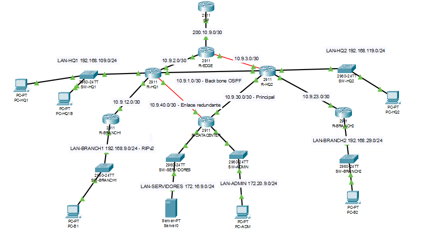

**Figura 2. Pruebas de ping entre LAN remotas.**

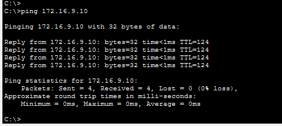

---

## 4. Inventario de equipos

| Elemento | Cantidad | Función |
|---|---|---|
| Routers Cisco 2911 | 6 + 1 ISP | Núcleo, sucursales, Data Center e Internet |
| Switches 2960 | 6 | Acceso LAN |
| PCs | 6 | Pruebas de conectividad |
| Servidor | 1 | Red de servicios (Data Center) |
| Cloud/ISP | 1 | Simulación de salida externa |

---

## 5. Plan de direccionamiento (tabla final, D = 9)

| Segmento | Red | Dispositivo | Interfaz | IP | Máscara |
|---|---|---|---|---|---|
| R-EDGE ↔ ISP | 200.10.9.0/30 | R-EDGE | g0/0 | 200.10.9.1 | 255.255.255.252 |
| | | ISP | g0/0 | 200.10.9.2 | 255.255.255.252 |
| R-EDGE ↔ R-HQ1 | 10.9.2.0/30 | R-EDGE | g0/1 | 10.9.2.1 | 255.255.255.252 |
| | | R-HQ1 | g0/0 | 10.9.2.2 | 255.255.255.252 |
| R-EDGE ↔ R-HQ2 (fibra) | 10.9.3.0/30 | R-EDGE | g0/3/0 | 10.9.3.1 | 255.255.255.252 |
| | | R-HQ2 | g0/2/0 | 10.9.3.2 | 255.255.255.252 |
| R-HQ1 ↔ R-HQ2 (backbone) | 10.9.1.0/30 | R-HQ1 | g0/1 | 10.9.1.1 | 255.255.255.252 |
| | | R-HQ2 | g0/0 | 10.9.1.2 | 255.255.255.252 |
| R-HQ1 ↔ R-BRANCH1 | 10.9.12.0/30 | R-HQ1 | g0/2 | 10.9.12.1 | 255.255.255.252 |
| | | R-BRANCH1 | g0/0 | 10.9.12.2 | 255.255.255.252 |
| R-HQ2 ↔ R-BRANCH2 | 10.9.23.0/30 | R-HQ2 | g0/1 | 10.9.23.1 | 255.255.255.252 |
| | | R-BRANCH2 | g0/0 | 10.9.23.2 | 255.255.255.252 |
| R-HQ2 ↔ R-DATACENTER (principal) | 10.9.30.0/30 | R-HQ2 | g0/2 | 10.9.30.1 | 255.255.255.252 |
| | | R-DATACENTER | g0/0 | 10.9.30.2 | 255.255.255.252 |
| R-HQ1 ↔ R-DATACENTER (redundante) | 10.9.40.0/30 | R-HQ1 | g0/3/0 | 10.9.40.1 | 255.255.255.252 |
| | | R-DATACENTER | g0/3/0 | 10.9.40.2 | 255.255.255.252 |
| LAN-HQ1 | 192.168.109.0/24 | R-HQ1 | Vlan10 | 192.168.109.1 | 255.255.255.0 |
| | | PC-HQ1 / PC-HQ1B | NIC | .10 / .11 | 255.255.255.0 |
| LAN-HQ2 | 192.168.119.0/24 | R-HQ2 | Vlan119 | 192.168.119.1 | 255.255.255.0 |
| | | PC-HQ2 | NIC | 192.168.119.10 | 255.255.255.0 |
| LAN-BRANCH1 | 192.168.9.0/24 | R-BRANCH1 | Vlan20 | 192.168.9.1 | 255.255.255.0 |
| | | PC-B1 | NIC | 192.168.9.10 | 255.255.255.0 |
| LAN-BRANCH2 | 192.168.29.0/24 | R-BRANCH2 | Vlan29 | 192.168.29.1 | 255.255.255.0 |
| | | PC-B2 | NIC | 192.168.29.10 | 255.255.255.0 |
| LAN-SERVIDORES | 172.16.9.0/24 | R-DATACENTER | Vlan16 | 172.16.9.1 | 255.255.255.0 |
| | | SERVER | NIC | 172.16.9.10 | 255.255.255.0 |
| LAN-ADMIN | 172.20.9.0/24 | R-DATACENTER | Vlan20 | 172.20.9.1 | 255.255.255.0 |
| | | PC-ADM | NIC | 172.20.9.10 | 255.255.255.0 |

**Router IDs OSPF:** R-HQ1 = 1.1.1.1, R-HQ2 = 2.2.2.2, R-EDGE = 3.3.3.3,
R-BRANCH2 = 4.4.4.4, R-DATACENTER = 5.5.5.5.

Nota de implementación: varias LAN se montaron sobre interfaces SVI (Vlan10,
Vlan20 en R-BRANCH1, Vlan119, Vlan29, Vlan16 y Vlan20 en R-DATACENTER) porque el
puerto físico disponible pertenece a un módulo HWIC-4ESW, que en Packet Tracer
funciona como switch de capa 2 y no acepta dirección IP directa. Se definieron las
VLANs en la base de datos de cada router modular y se asociaron los puertos de
acceso de los switches correspondientes, evitando discrepancias de VLAN nativa.
(La Vlan20 de R-BRANCH1 y la Vlan20 de R-DATACENTER son locales a cada router y no
entran en conflicto, al pertenecer a dominios de switching independientes.)

---

## 6. Fase I — Construcción, cableado y direccionamiento

Se asignaron hostname, descripciones y direcciones IP a todos los routers, se
activaron las interfaces con `no shutdown` y se configuró IP, máscara y gateway en
los equipos finales. El enlace de borde R-EDGE ↔ R-HQ2 se resolvió con módulos
transceptores HWIC-1GE-SFP y cable de fibra óptica monomodo (g0/3/0 en R-EDGE y
g0/2/0 en R-HQ2), al estar ocupados los puertos integrados RJ-45. Se comprobó
conectividad entre vecinos directos con `ping`.

**Figura 3. `show ip interface brief` de R-EDGE.**

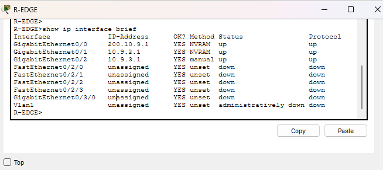

**Figura 4. `show ip interface brief` de R-HQ1 (incluye Vlan10 de la LAN-HQ1).**

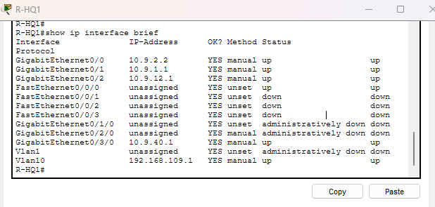

**Figura 5. `show ip interface brief` de R-BRANCH1 (incluye Vlan20 de la LAN-BRANCH1).**

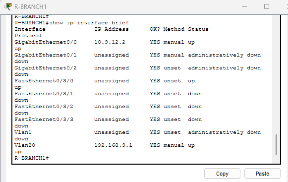

**Figura 6. `show ip interface brief` de R-HQ2.**

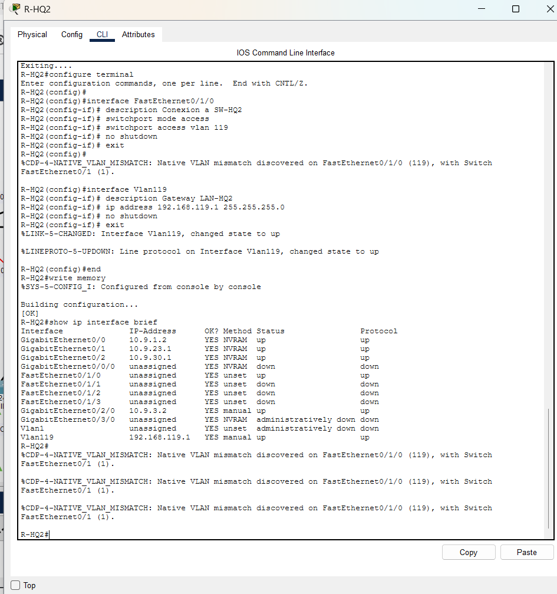

**Figura 7. `show ip interface brief` de R-BRANCH2.**

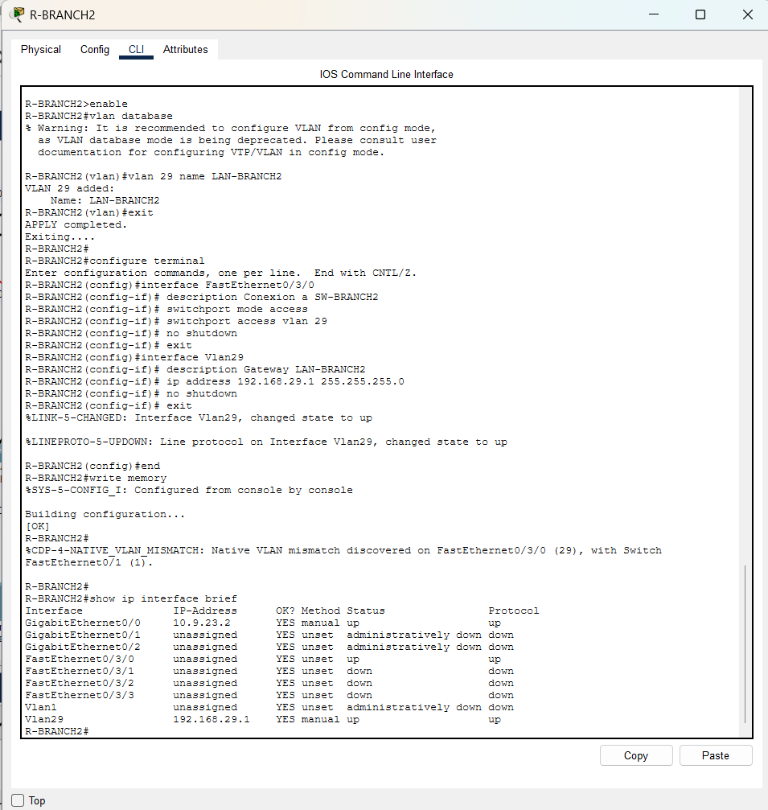

**Figura 8. `show ip interface brief` de R-DATACENTER.**

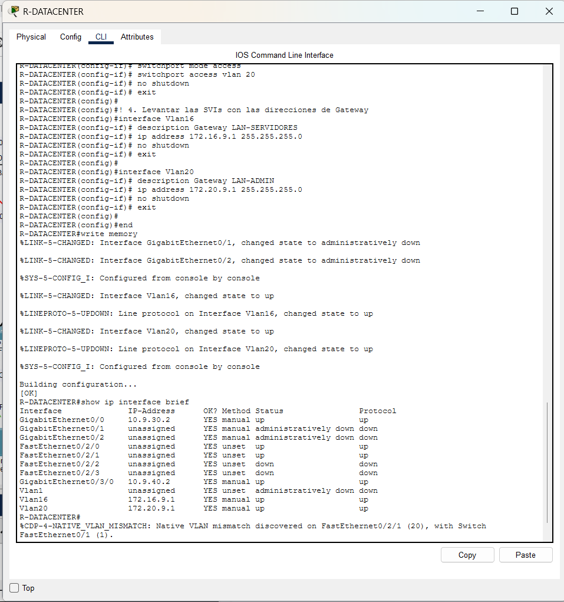

---

## 7. Fase II — Enrutamiento estático

Se configuraron los mecanismos estáticos exigidos: una ruta por defecto y una
ruta estática flotante.

En R-EDGE, ruta por defecto hacia el ISP:

```
ip route 0.0.0.0 0.0.0.0 200.10.9.2
```

En R-HQ1, ruta estática flotante hacia la red de servidores (172.16.9.0/24) por el
enlace redundante, con distancia administrativa 130:

```
ip route 172.16.9.0 255.255.255.0 10.9.40.2 130
```

La AD 130 es mayor que la de OSPF (110), por lo que esta ruta permanece inactiva
mientras OSPF entregue la red de servidores por el camino principal, y se instala
en la tabla solamente cuando el enlace principal falla. Su activación se comprueba
en la Fase VI (prueba de falla).

**Figura 9. Ruta estática y ruta por defecto — tabla de rutas de R-HQ2 (ruta por
defecto `O*E2 0.0.0.0/0`).**

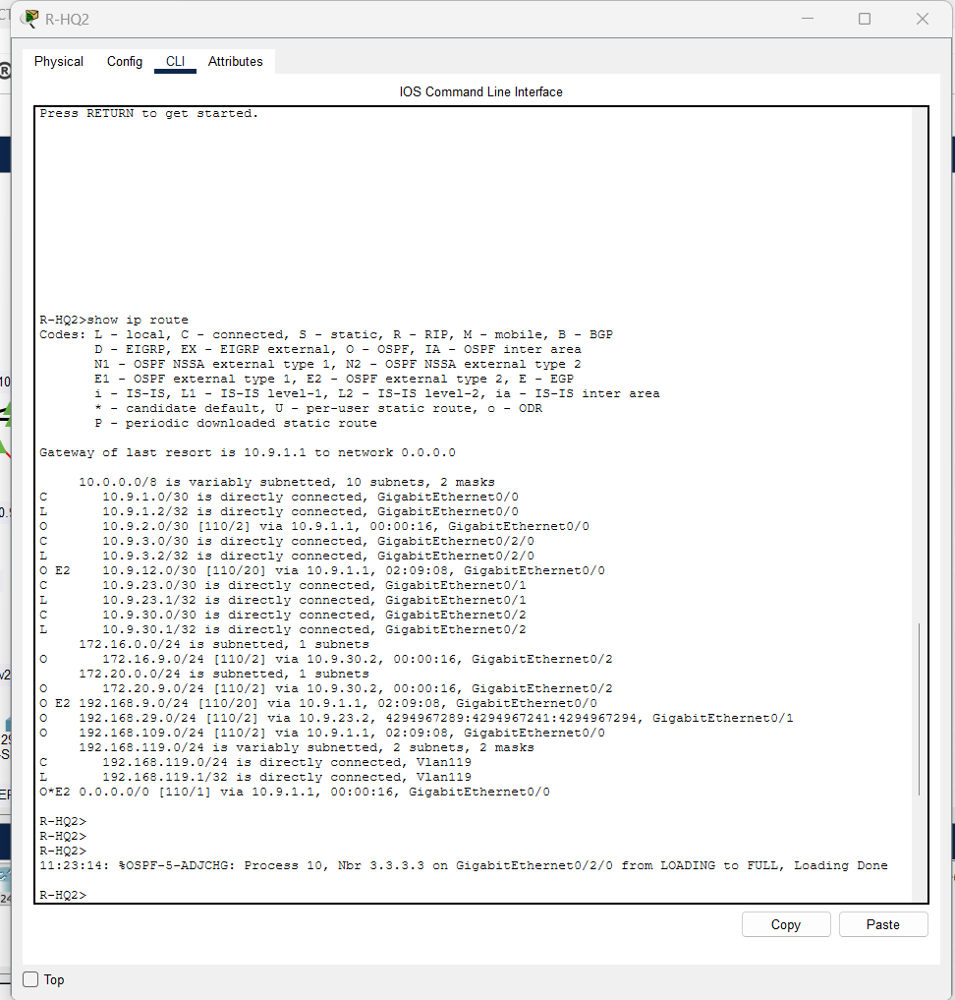

---

## 8. Fase III — RIPv2 en la Sucursal Norte (R-BRANCH1)

R-BRANCH1 representa la infraestructura heredada. Configuración:

```
router rip
 version 2
 no auto-summary
 network 192.168.9.0
 network 10.0.0.0
```

- Versión 2 confirmada.
- `no auto-summary` activo: necesario porque R-BRANCH1 tiene interfaces en dos
  redes mayores distintas (10.0.0.0/8 y 192.168.9.0/24); sin él, RIPv2 resumiría a
  los límites classful y se perdería la información de subred VLSM (/30).
- Métrica de RIP: conteo de saltos (hop count), con límite de 15 saltos; 16 = red
  inalcanzable.
- R-HQ1 es el router que anuncia hacia el núcleo las redes de la sucursal.

**Figura 10. Evidencia de rutas RIPv2 — `show ip route` de R-BRANCH1.**

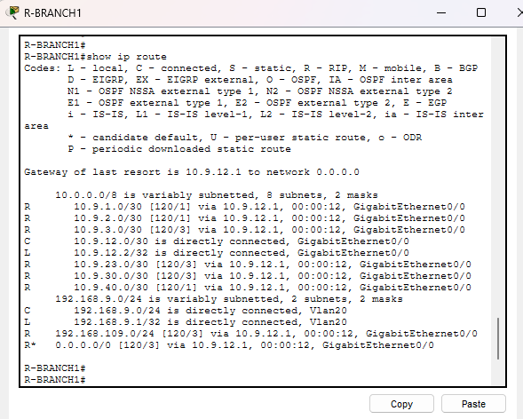

**Figura 11. `show ip protocols` de R-BRANCH1 (versión 2, no auto-summary).**

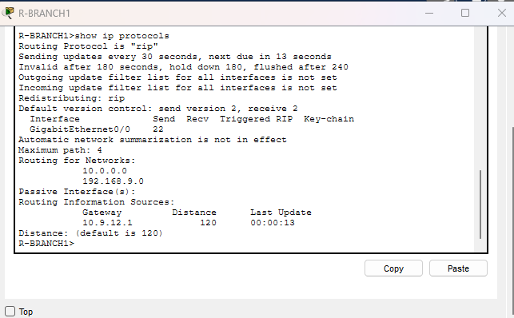

---

## 9. Fase IV — OSPF en el núcleo corporativo y Data Center

R-EDGE, R-HQ1, R-HQ2, R-BRANCH2 y R-DATACENTER forman el dominio OSPF de área única
(area 0). Se configuraron manualmente los Router IDs para garantizar estabilidad y
evitar reelecciones arbitrarias. Se declararon las redes WAN punto a punto (/30 con
wildcard 0.0.0.3) y los segmentos de acceso LAN (/24 con wildcard 0.0.0.255).

R-HQ1 (Router ID 1.1.1.1):

```
router ospf 10
 router-id 1.1.1.1
 network 10.9.1.0 0.0.0.3 area 0
 network 10.9.2.0 0.0.0.3 area 0
 network 10.9.40.0 0.0.0.3 area 0
 network 192.168.109.0 0.0.0.255 area 0
```

R-HQ2 (Router ID 2.2.2.2):

```
router ospf 10
 router-id 2.2.2.2
 network 10.9.1.0 0.0.0.3 area 0
 network 10.9.3.0 0.0.0.3 area 0
 network 10.9.23.0 0.0.0.3 area 0
 network 10.9.30.0 0.0.0.3 area 0
 network 192.168.119.0 0.0.0.255 area 0
```

R-DATACENTER (Router ID 5.5.5.5):

```
router ospf 10
 router-id 5.5.5.5
 network 10.9.30.0 0.0.0.3 area 0
 network 10.9.40.0 0.0.0.3 area 0
 network 172.16.9.0 0.0.0.255 area 0
 network 172.20.9.0 0.0.0.255 area 0
```

Los enlaces punto a punto del Data Center se configuraron con
`ip ospf network point-to-point` para formar adyacencia directa. Todas las
adyacencias se establecieron en estado FULL, conformando la topología mallada del
núcleo. En R-HQ2 se comprobó la recepción de las rutas internas del núcleo (`O`),
la inyección de la ruta por defecto originada en R-EDGE (`O*E2 0.0.0.0/0`) y la
propagación de la sucursal legacy mediante la redistribución efectuada en R-HQ1.

**Figura 12. Vecinos OSPF de R-HQ1 (adyacencias FULL con R-EDGE, R-HQ2 y
R-DATACENTER).**

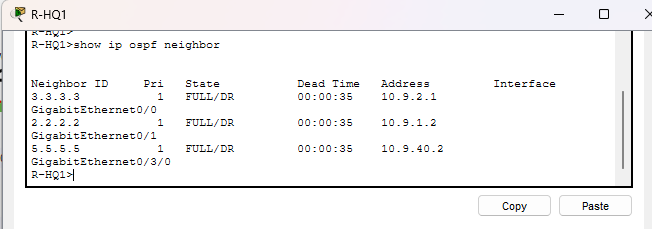

**Figura 13. Vecinos OSPF de R-HQ2 (cuatro adyacencias FULL con R-HQ1, R-EDGE,
R-BRANCH2 y R-DATACENTER).**

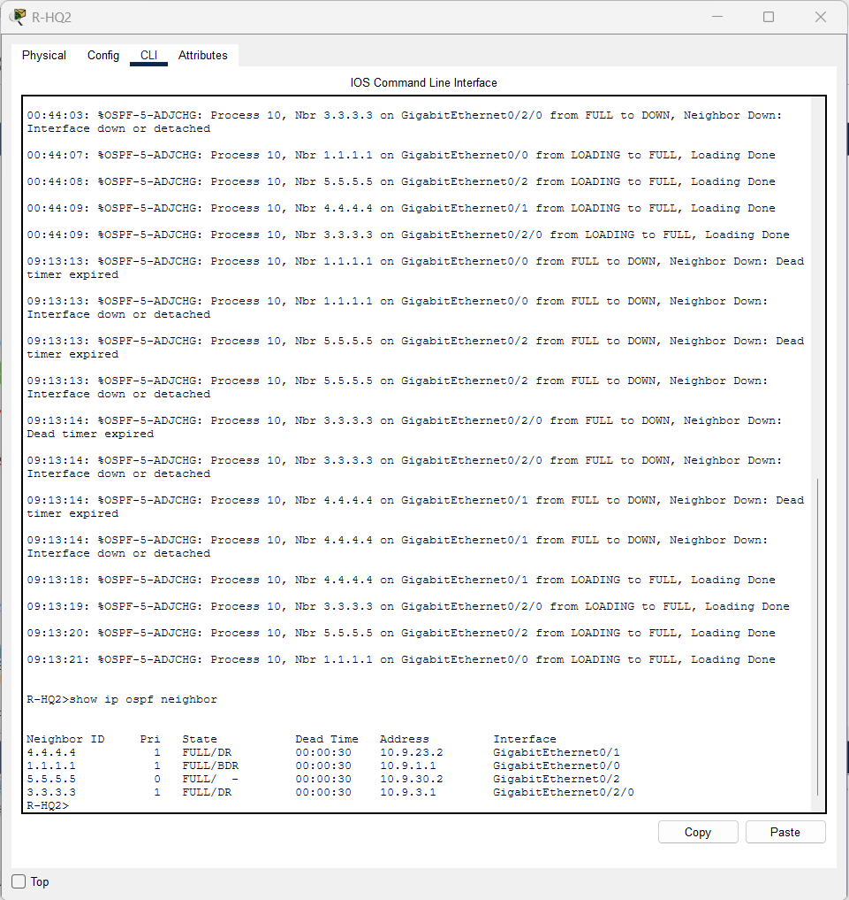

**Figura 14. Vecinos OSPF de R-DATACENTER (FULL con R-HQ2 y R-HQ1).**

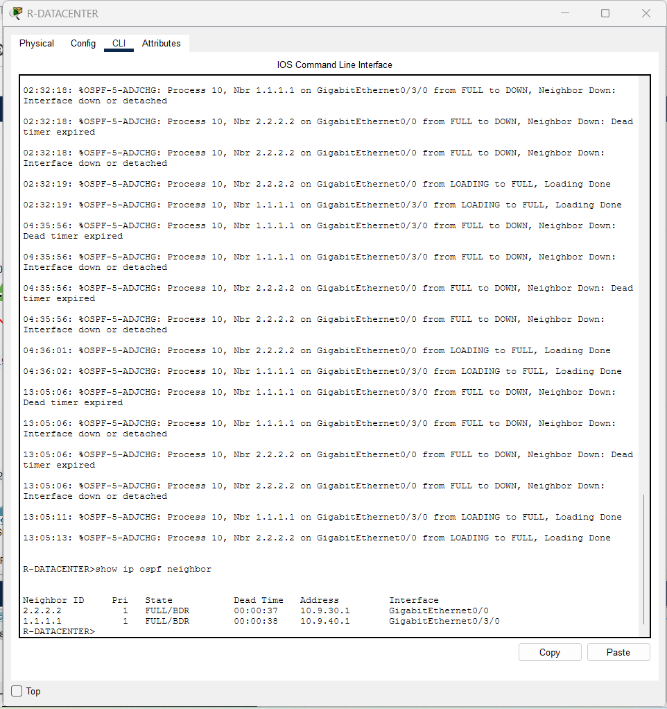

---

## 10. Fase V — Integración RIPv2 ↔ OSPF y comparación de rutas

El punto de integración entre el dominio heredado RIPv2 y el núcleo OSPF se ubicó
en R-HQ1, mediante **redistribución mutua**:

```
router rip
 version 2
 no auto-summary
 network 10.0.0.0
 redistribute ospf 10 metric 3
!
router ospf 10
 redistribute rip subnets
```

Justificación: el enunciado prohíbe resolver la integración agregando una ruta
estática por cada red. La redistribución mutua concentra el borde entre dominios
en un único router (R-HQ1, que se convierte en ASBR), permite que las redes del
núcleo lleguen a R-BRANCH1 como código `R`, y que la LAN de la sucursal legacy
(192.168.9.0/24) se propague al dominio OSPF.

Comparación de distancia administrativa y métrica:
- OSPF tiene AD 110 y usa costo basado en ancho de banda.
- RIP tiene AD 120 y usa conteo de saltos.
- La ruta estática flotante tiene AD 130.
- Ante una red alcanzable por varios mecanismos, se instala la de menor AD. Por
  eso la red de servidores se entrega por OSPF (110) y no por la flotante (130) en
  condiciones normales.

Red alcanzable por más de un mecanismo: la LAN de la sucursal legacy
(192.168.9.0/24) es conocida en RIP dentro de su dominio y, por redistribución, se
propaga como ruta OSPF al núcleo. En R-DATACENTER aparece aprendida vía OSPF
(`Known via "ospf 10"`, from 1.1.1.1), confirmando la integración entre ambos
dominios.

**Figura 15. Rutas RIP tras redistribución en R-BRANCH1 (redes del núcleo como
`R`).**

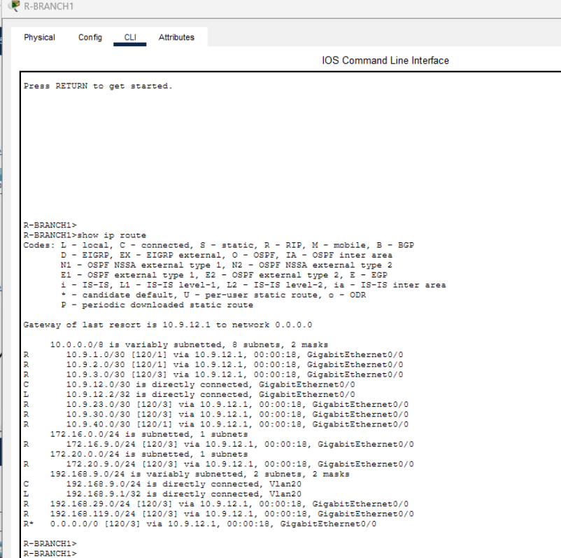

---

## 11. Fase VI — Redundancia, costos OSPF y simulación de falla

Se habilitó el enlace redundante R-HQ1 ↔ R-DATACENTER y se aplicó ingeniería de
costos OSPF en R-DATACENTER para definir un camino principal (por R-HQ2) y uno
alternativo (por R-HQ1):

```
interface g0/0
 ip ospf cost 10
!
interface g0/3/0
 ip ospf cost 50
```

De este modo, el cálculo SPF selecciona por defecto el tránsito hacia R-HQ2 al
ofrecer una métrica acumulada menor hacia los destinos del núcleo.

Procedimiento de la prueba de falla:
1. Antes de la falla, `tracert` desde PC-ADM hacia PC-HQ1 (192.168.109.10) recorre
   el camino preferente R-DATACENTER → R-HQ2 → R-HQ1 → PC-HQ1.
2. Se provocó la desconexión del camino primario con `shutdown` de la interfaz
   `GigabitEthernet0/2` en R-HQ2.
3. Al detectarse la pérdida del enlace, OSPF recalculó la topología y conmutó el
   tráfico de forma automática hacia el enlace redundante 10.9.40.0/30
   (next-hop 10.9.40.1 de R-HQ1), y la ruta estática flotante se activó.
4. Tras reactivar el enlace principal con `no shutdown`, la adyacencia OSPF se
   restableció en estado FULL y el árbol de rutas reincorporó la interfaz
   GigabitEthernet0/0 como vía óptima sin intervención administrativa.

**Figura 16. Ruta antes de la falla — tracert desde PC-ADM a PC-HQ1.**

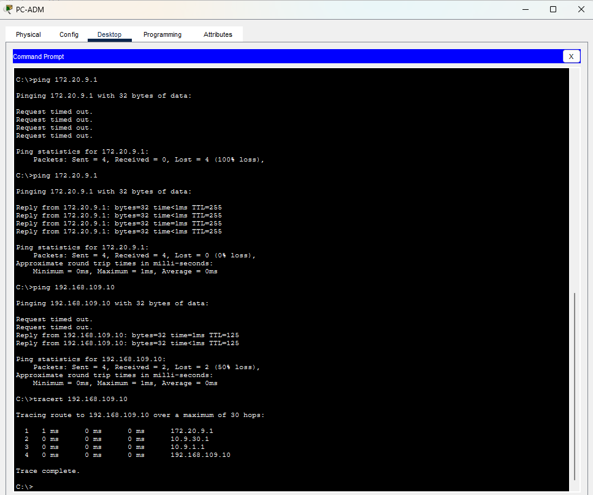

**Figura 17. Nuevo camino tras la falla — tracert desde PC-ADM a PC-HQ1.**

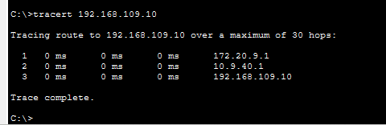

**Figura 18. Ruta estática flotante activada — tabla de rutas de R-HQ1 tras la
falla.**

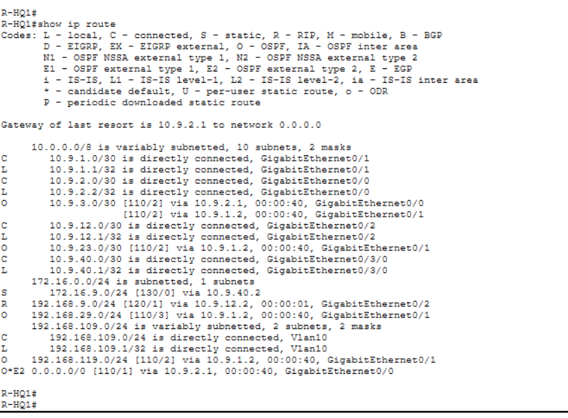

**Figura 19. Tabla de rutas de R-DATACENTER durante la falla.**

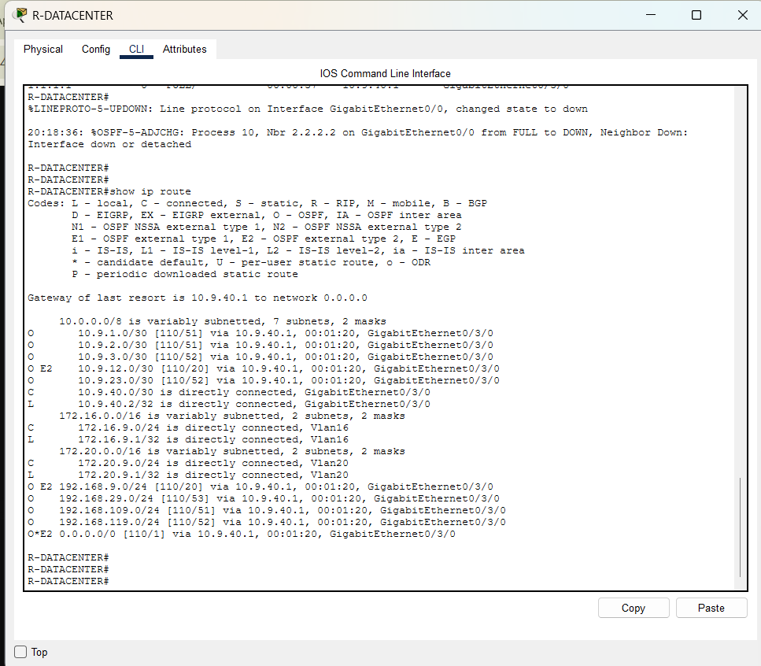

**Figura 20. Recuperación del enlace — tabla de rutas de R-DATACENTER restaurada.**

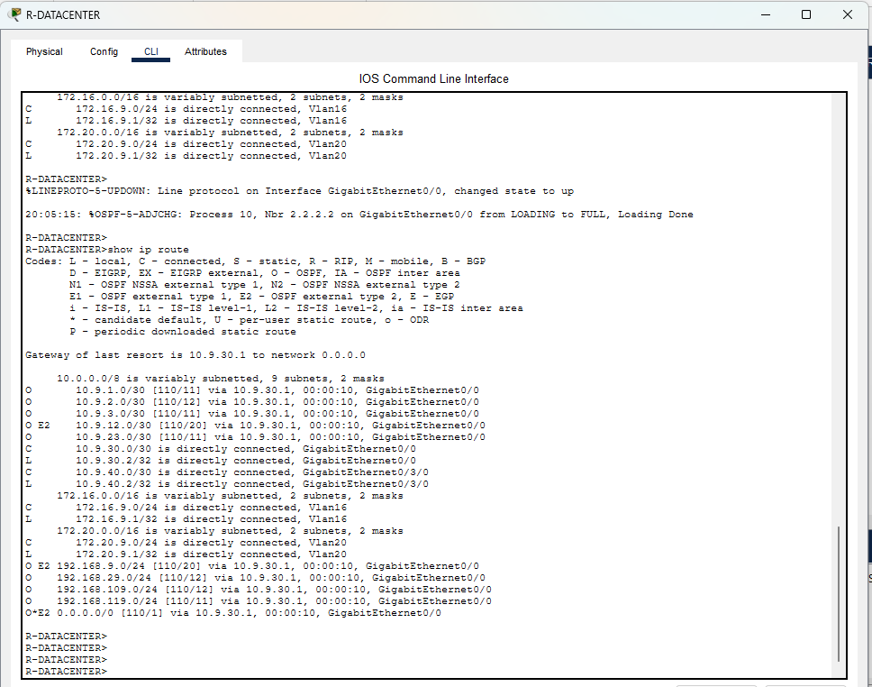

La Figura 18 evidencia que, al caer el enlace principal, la ruta a 172.16.9.0/24 se
instala por la estática flotante (next-hop 10.9.40.2, AD 130), cumpliendo el
análisis obligatorio: la ruta flotante no se instala mientras exista una ruta con
menor distancia administrativa (OSPF), y aparece en la tabla solo cuando la ruta
principal falla.

---

## 12. Fase VII — Caso de IA aplicada al enrutamiento

Se implementó el prototipo AI Routing Advisor. El análisis se dividió en dos
escenarios complementarios, uno por cada dominio de la red.

### 12.1 Escenario 1 — Dominio RIPv2 / integración (R-HQ1 y R-BRANCH1)

**Prompt entregado:**

```
Actua como ingeniero de redes senior (AI Routing Advisor). Te comparto salidas
reales de Cisco IOS de dos routers de una red empresarial que combina RIPv2 y
OSPF con redistribucion mutua en R-HQ1.
1. Identifica todas las rutas RIP, OSPF y estaticas visibles.
2. Determina que ruta esta instalada hacia la red de servidores (172.16.9.0/24)
   y explica por que, mencionando distancia administrativa y metrica.
3. Verifica si la redistribucion RIP <-> OSPF esta correctamente configurada en
   R-HQ1 e indica si falta algun parametro.
4. Confirma si "no auto-summary" esta activo en R-BRANCH1 y explica por que es
   necesario con la red 10.0.0.0.
5. Propone comandos adicionales de Cisco IOS para confirmar el diagnostico.
```

**Resumen de la respuesta de la IA:**
- Identificó correctamente las rutas OSPF (`O`), RIP (`R`), estáticas (`S`) y la
  ruta por defecto externa (`O*E2`).
- Explicó correctamente la función de `no auto-summary` en R-BRANCH1.
- Detectó que la redistribución estaba incompleta: existía OSPF→RIP pero faltaba
  `redistribute rip` dentro de OSPF, por lo que las redes de la sucursal legacy no
  se propagaban al núcleo.
- Señaló que la ruta flotante hacia servidores podía instalarse antes de tiempo si
  OSPF no anunciaba aún la red 172.16.9.0/24.

**Validación técnica:** la recomendación resultó parcialmente correcta y útil.
Acertó en un hallazgo real: la redistribución RIP→OSPF faltaba. Se aplicó
`redistribute rip subnets` en OSPF de R-HQ1, R-HQ1 pasó a ser ASBR y la red
192.168.9.0/24 apareció como ruta OSPF en el núcleo (corrección confirmada). Su
advertencia sobre la ruta flotante dependía de la configuración del Data Center;
una vez anunciada la red de servidores por OSPF, la flotante quedó correctamente
inactiva.

### 12.2 Escenario 2 — Núcleo OSPF / costos y falla (R-HQ2 y R-DATACENTER)

**Prompt entregado:**

```
Actua como ingeniero de redes senior. A continuacion te comparto salidas reales
de Cisco IOS tomadas de dos routers del nucleo OSPF de una red empresarial. El
Data Center tiene dos caminos OSPF: uno principal por R-HQ2 (costo 10) y uno
redundante por R-HQ1 (costo 50). Durante la prueba se simulo una falla en el
enlace principal.
1. Identifica las adyacencias OSPF activas y en que area operan.
2. Determina que ruta esta instalada hacia la red 192.168.109.0/24 y explica
   por que, en terminos de costo OSPF.
3. Diagnostica si la red mantiene conectividad al Data Center durante la falla
   del enlace principal, usando como evidencia los costos y las interfaces
   visibles.
4. Explica la relacion entre `ip ospf cost` y la seleccion de ruta.
5. Propone tres comandos Cisco IOS para verificar la convergencia tras la falla.
```

**Resumen de la respuesta de la IA:**
- Adyacencias: identificó que R-HQ2 opera en Área 0 con 4 vecinos FULL (R-HQ1,
  R-EDGE, R-BRANCH2 y R-DATACENTER) y R-DATACENTER con 2 vecinos FULL (R-HQ2 y
  R-HQ1).
- Selección de ruta: determinó que hacia la LAN-HQ1 (192.168.109.0/24),
  R-DATACENTER instala la ruta vía R-HQ2 (10.9.30.1) con métrica acumulada 12
  (`[110/12]`), resultado de sumar el costo del enlace principal (10) más los
  costos internos de tránsito (1 + 1), prefiriéndola sobre el enlace redundante que
  acumula costo 51.
- Resiliencia: diagnosticó que la red mantiene conectividad ininterrumpida al Data
  Center durante la caída del camino principal, pues el enlace redundante asume el
  tráfico conmutando al next-hop 10.9.40.1.
- Ingeniería de costos: explicó que `ip ospf cost` sobrescribe la fórmula
  automática basada en el ancho de banda, permitiendo forzar rutas deterministas.
- Comandos propuestos: `show ip ospf neighbor`, `show ip route ospf` y `traceroute`.

**Validación técnica:** fue contrastada contra el comportamiento operativo en
Packet Tracer. El desglose aritmético de métricas (10 + 1 + 1 = 12 vs 50 + 1 = 51)
fue exacto y coincidió con las tablas de enrutamiento, y la explicación del
algoritmo Dijkstra frente al costo manual fue certera. Sin embargo, la IA asumió
una reconvergencia inmediata y transparente, omitiendo el impacto de los
temporizadores OSPF (Dead Interval de 40 s en medios broadcast) y la necesidad de
homologar los tipos de red (`ip ospf network point-to-point`), factor que
previamente generó un bloqueo temporal en la instalación de rutas en R-HQ2.

### 12.3 Conclusión del caso de IA

La IA demostró ser un asistente de soporte eficiente para el análisis de
redistribución, el cálculo analítico de costos y la correlación de tablas de
enrutamiento; de hecho detectó una configuración de redistribución incompleta que
aceleró su corrección. No obstante, carece de visión contextual sobre
particularidades de capa física y discrepancias de parámetros en interfaces. Toda
recomendación de IA debe ser validada técnicamente por el administrador; la IA
apoya al administrador, no lo reemplaza, y no sustituye al protocolo de
enrutamiento.

---

## 13. Troubleshooting oculto (metodología de detección rápida)

Para afrontar la prueba de diagnóstico en vivo ante modificaciones no anunciadas
por el docente, se estructuró la siguiente metodología:

| Posible falla provocada | Síntoma en la red | Comando de detección | Acción correctiva |
|---|---|---|---|
| Eliminación de `network` en RIP | La sucursal deja de alcanzar redes remotas | `show ip protocols` en R-BRANCH1 | Agregar `network <red>` bajo `router rip` |
| Wildcard errónea en OSPF | Falta de adyacencia o subred no publicada | `show running-config \| section ospf` | Corregir la máscara wildcard a 0.0.0.3 o 0.0.0.255 |
| Interfaz apagada administrativamente | Pérdida de adyacencia y caída de enlaces | `show ip interface brief` | Entrar a la interfaz y aplicar `no shutdown` |
| Gateway o máscara alterada en host | Host aislado sin salida fuera de su LAN | `ipconfig` en la estación afectada | Restablecer IP estática, máscara y gateway |
| Modificación de ruta estática / por defecto | Pérdida de salida a Internet | `show ip route static` en R-EDGE | Reconfigurar `ip route 0.0.0.0 0.0.0.0 200.10.9.2` |
| Supresión de `no auto-summary` en RIP | Rutas recibidas como clase mayor | `show ip protocols` en R-BRANCH1 | Aplicar `no auto-summary` en el proceso RIP |
| Modificación de IP o máscara en WAN | Adyacencia OSPF trabada en INIT o DOWN | `show ip interface brief` y `ping` al vecino | Homologar IPs dentro del segmento /30 |
| Alteración de costo OSPF | Tráfico por camino no óptimo | `show ip ospf interface brief` | Restablecer `ip ospf cost` al valor de diseño |

---

## 14. Preguntas técnicas de defensa

**1. ¿Por qué OSPF es más adecuado para el núcleo que RIP?**
Porque OSPF es un protocolo de estado de enlace sin límite de saltos (RIP se limita
a 15), converge rápido mediante el algoritmo Dijkstra (SPF), calcula métricas
basadas en costo real (ancho de banda) en lugar de saltos, soporta diseño
jerárquico por áreas y genera menor sobrecarga al enviar actualizaciones disparadas
por eventos en lugar de tablas periódicas completas.

**2. ¿Qué métrica utiliza RIP y cuál es su límite?**
Conteo de saltos (hop count). Límite de 15 saltos; 16 significa red inalcanzable.

**3. ¿Qué representa el costo en OSPF?**
Es el costo métrico acumulado de los enlaces para alcanzar un destino. Por defecto,
Cisco IOS lo calcula inversamente proporcional al ancho de banda (Costo =
Ancho de Banda de Referencia / Ancho de Banda de la interfaz, típicamente 10^8/BW).
A menor costo acumulado, mayor preferencia del camino.

**4. ¿Cuál es la diferencia entre métrica y distancia administrativa?**
La distancia administrativa (AD) decide entre protocolos distintos (Estática = 1,
OSPF = 110, RIP = 120) cuál fuente instala la ruta en la tabla. La métrica es el
valor interno que usa un mismo protocolo (saltos en RIP, costo en OSPF) para elegir
el mejor camino dentro de su dominio. Primero se compara AD; a igualdad de fuente,
se compara métrica.

**5. ¿Por qué una ruta estática puede ser preferida a una ruta RIP?**
Porque la AD de una ruta estática (1) es menor que la de RIP (120). A menor AD,
mayor preferencia, así que la estática se instala sobre la ruta RIP aunque esta
exista.

**6. ¿Cómo se convierte una ruta estática en ruta flotante?**
Agregando al final del comando una AD mayor que la del protocolo dinámico que cubre
esa red. Ejemplo: `ip route 172.16.9.0 255.255.255.0 10.9.40.2 130`. El 130 la
mantiene inactiva mientras exista una ruta con menor AD, y se activa solo cuando esa
ruta desaparece.

**7. ¿Qué ocurre cuando un vecino OSPF deja de estar disponible?**
Si el enlace físico cae, la interfaz pasa a down y la adyacencia cae de inmediato.
Si el enlace sigue activo pero el vecino deja de responder, el router espera a que
expire el Dead Interval (40 s por defecto). Al expirar, la adyacencia pasa a DOWN,
el router genera un nuevo Router LSA (Tipo 1), lo inunda en el área y ejecuta SPF
para recalcular rutas omitiendo al vecino inalcanzable.

**8. ¿Cómo se verifica una adyacencia OSPF?**
Con `show ip ospf neighbor`: el estado debe ser FULL (o 2-WAY entre DROTHER en
segmentos multiacceso). Para detalle de temporizadores y prioridad se usa
`show ip ospf neighbor detail`.

**9. ¿Qué función cumple `no auto-summary` en RIPv2?**
Desactiva la sumarización automática a los límites classful. Es necesario con
subredes VLSM o redes discontinuas, para que RIPv2 envíe la máscara real de cada
subred y no se pierda información de enrutamiento.

**10. ¿Puede una IA reemplazar OSPF? Justifique.**
No. OSPF opera en el plano de control distribuido dentro de los enrutadores en
tiempo real, garantizando el intercambio de estados de enlace y la prevención
algorítmica de bucles. La IA opera en el plano de gestión y supervisión analítica
(diagnóstico, detección de anomalías, planificación), pero no tiene convergencia
determinista local ni tolerancia a fallas descentralizada en milisegundos. Sus
recomendaciones deben validarse.

**11. ¿Qué salidas de IOS son más útiles para diagnosticar una falla de
enrutamiento?**
`show ip route`, `show ip protocols`, `show ip ospf neighbor`,
`show ip interface brief`, y `ping` / `tracert` para comprobar alcance y camino
real.

**12. ¿Por qué una recomendación de IA debe validarse antes de aplicarse?**
Porque la IA basa sus respuestas en correlación de patrones, puede alucinar, omitir
particularidades físicas de la topología (módulos switch de capa 2, tipos de red en
interfaces) o desconocer directivas de diseño. Aplicar cambios sin validación en
producción puede provocar caídas de servicio, bucles o inconsistencias de
conectividad.

---

## 15. Inventario de evidencias (según la rúbrica del enunciado)

| No. | Evidencia | Archivo / Sección |
|---|---|---|
| 1 | Archivo .pkt funcional y nombrado con carné | ProyectoIntegrador_202300659_202300673.pkt |
| 2 | Topología completa con etiquetas de red | Topologia.png (Figura 1) |
| 3 | Tabla final de direccionamiento | Sección 5 |
| 4 | show ip interface brief de routers | 01, 02, 03, 10, 11, 12 |
| 5 | show ip route de routers principales | 05, 08, 09, 15, 18, 19 |
| 6 | show ip protocols | 06 |
| 7 | show ip ospf neighbor | 07, 13, 14 |
| 8 | Pruebas ping entre LAN remotas | 20 |
| 9 | tracert hacia Data Center | 16, 17 |
| 10 | Evidencia de rutas RIPv2 | 05 |
| 11 | Evidencia de rutas OSPF | 07, 13, 14 |
| 12 | Ruta estática y ruta por defecto | 15 |
| 13 | Ruta estática flotante y prueba de activación | 09 |
| 14 | Prueba de falla y recuperación | 17, 18, 19 |
| 15 | Análisis realizado mediante IA | Sección 12.1 y 12.2 |
| 16 | Validación técnica de la respuesta de IA | Sección 12.1, 12.2 y 12.3 |
| 17 | Conclusiones técnicas del estudiante | Sección 16 |

---

## 16. Conclusiones técnicas

1. La coexistencia armónica de protocolos heterogéneos (RIPv2 y OSPF) es viable y
   eficiente mediante redistribución mutua en enrutadores de frontera (ASBR),
   preservando segmentos de red heredados sin comprometer la velocidad de
   convergencia del núcleo. La redistribución quedó verificada en ambos sentidos.

2. El uso correcto de la distancia administrativa permitió implementar una ruta
   estática flotante que se mantiene inactiva mientras OSPF opera y se activa solo
   ante la falla del enlace principal. La red continuó operativa ante una falla
   controlada, reconvergió por el camino alterno y se recuperó automáticamente al
   restaurar el enlace.

3. La ingeniería de costos OSPF (`ip ospf cost`) permitió definir de forma
   explícita un camino principal (costo 10) y uno de respaldo (costo 50) hacia el
   Data Center, demostrando el control determinista de selección de rutas que ofrece
   OSPF frente a RIP.

4. El uso de interfaces virtuales de conmutación (SVI) en enrutadores modulares
   resolvió las limitaciones de puertos físicos de capa 3 de los módulos HWIC-4ESW,
   manteniendo la coherencia del diseño y la compatibilidad con los dispositivos
   finales.

5. La interpretación de las tablas de enrutamiento (códigos O, R, S, S*, next-hop,
   distancia administrativa y métrica) fue clave para validar el comportamiento de
   la red, más allá de mostrar capturas, logrando conectividad extremo a extremo
   entre todas las LAN sin resolver el proyecto exclusivamente con rutas estáticas.

6. Las herramientas de Inteligencia Artificial son un recurso valioso para acelerar
   el análisis y la interpretación de diagnósticos —en este proyecto detectaron una
   redistribución incompleta—, pero su función debe ser estrictamente consultiva,
   requiriendo siempre la validación y el criterio técnico del ingeniero de redes
   antes de su aplicación en producción.

7. El trabajo en pareja permitió dividir la red en un dominio de borde/legacy
   (Integrante 1) y un núcleo/Data Center (Integrante 2), integrados sobre el
   backbone OSPF, reflejando la coordinación necesaria en un entorno real de
   administración de redes.