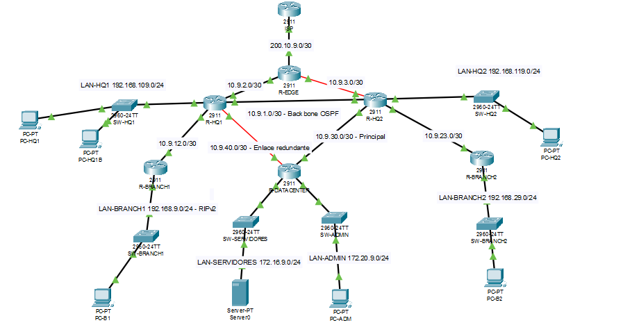
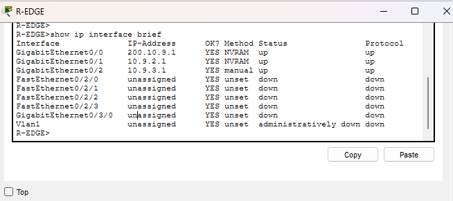
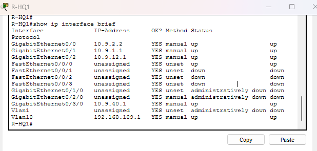
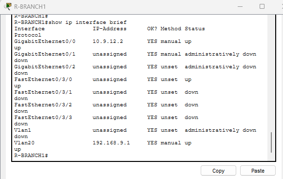
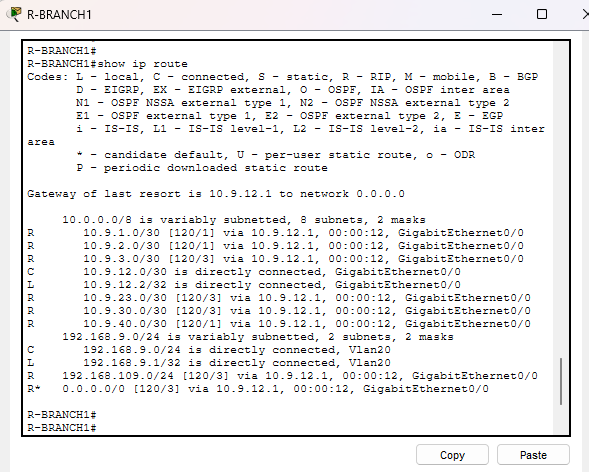
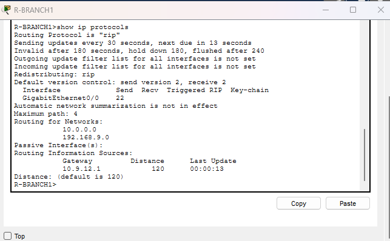

# Informe Técnico - Proyecto Integrador (Parte Integrante 1)

**Curso:** Redes de Computadoras 2
**Universidad:** USAC - Facultad de Ingeniería
**Integrante 1:** Carné 202300659
**Valor de D (personalización):** 9


---

## 1. Introducción

TecnoRed Guatemala, S.A. requiere reorganizar su infraestructura de enrutamiento
integrando rutas estáticas, una sucursal heredada con RIPv2 y un núcleo
corporativo en OSPF de área única. Esta parte del informe documenta el diseño,
la implementación y la verificación del borde de la red (R-EDGE), la casa matriz
HQ1 y la sucursal heredada R-BRANCH1, así como el punto de integración entre el
dominio RIPv2 y el dominio OSPF.

### 1.1 Topolgía 


---

## 2. Plan de direccionamiento (segmentos del Integrante 1)

Valor de D = 9.

| Segmento | Red | Dispositivo | Interfaz | IP |
|---|---|---|---|---|
| R-EDGE ↔ ISP | 200.10.9.0/30 | R-EDGE | g0/0 | 200.10.9.1 |
| | | ISP | g0/0 | 200.10.9.2 |
| R-EDGE ↔ R-HQ1 | 10.9.2.0/30 | R-EDGE | g0/1 | 10.9.2.1 |
| | | R-HQ1 | g0/0 | 10.9.2.2 |
| R-HQ1 ↔ R-HQ2 (backbone) | 10.9.1.0/30 | R-HQ1 | g0/1 | 10.9.1.1 |
| R-HQ1 ↔ R-BRANCH1 | 10.9.12.0/30 | R-HQ1 | g0/2 | 10.9.12.1 |
| | | R-BRANCH1 | g0/0 | 10.9.12.2 |
| R-HQ1 ↔ R-DATACENTER (redundante) | 10.9.40.0/30 | R-HQ1 | g0/3/0 | 10.9.40.1 |
| LAN-HQ1 | 192.168.109.0/24 | R-HQ1 | Vlan10 | 192.168.109.1 |
| | | PC-HQ1 | NIC | 192.168.109.10 |
| | | PC-HQ1B | NIC | 192.168.109.11 |
| LAN-BRANCH1 | 192.168.9.0/24 | R-BRANCH1 | Vlan20 | 192.168.9.1 |
| | | PC-B1 | NIC | 192.168.9.10 |

Nota de implementación: las LAN de HQ1 y BRANCH1 se montaron sobre interfaces SVI
(Vlan10 y Vlan20) porque el puerto físico disponible pertenece a un módulo
HWIC-4ESW, que en Packet Tracer funciona como switch y no acepta dirección IP
directa. La SVI resuelve esto sin cambiar el cableado.

---

## 3. Fase I - Construcción, cableado y direccionamiento

Se asignaron hostname, descripciones y direcciones IP a R-EDGE, R-HQ1 y
R-BRANCH1, y se activaron las interfaces con `no shutdown`. Se comprobó
conectividad entre vecinos directos con `ping`.

**Evidencia:**

- Figura 1. Interfaces de R-EDGE — `01_show_ip_int_brief_R-EDGE.png`



- Figura 2. Interfaces de R-HQ1 (incluye Vlan10 de la LAN-HQ1) — `02_show_ip_int_brief_R-HQ1.png`



- Figura 3. Interfaces de R-BRANCH1 (incluye Vlan20 de la LAN-BRANCH1) — `03_show_ip_int_brief_R-BRANCH1.png`



---

## 4. Fase II - Enrutamiento estático

En R-EDGE se configuró la ruta por defecto hacia el ISP:

```
ip route 0.0.0.0 0.0.0.0 200.10.9.2
```

En R-HQ1 se configuró una ruta estática flotante hacia la red de servidores
(172.16.9.0/24) por el enlace redundante, con distancia administrativa 130:

```
ip route 172.16.9.0 255.255.255.0 10.9.40.2 130
```

La AD 130 (mayor que la de OSPF, 110) garantiza que esta ruta permanezca inactiva
mientras OSPF entregue la red por el camino principal, y se active solo ante una
falla. La validación de su activación corresponde a la prueba de falla
(Integrante 2).

---

## 5. Fase III - RIPv2 en la Sucursal Norte (R-BRANCH1)

R-BRANCH1 representa la infraestructura heredada. Se configuró RIPv2 así:

```
router rip
 version 2
 no auto-summary
 network 192.168.9.0
 network 10.0.0.0
```

- Versión 2 confirmada.
- `no auto-summary` activo: necesario porque R-BRANCH1 tiene interfaces en dos
  redes mayores distintas (10.0.0.0/8 y 192.168.9.0/24); sin él, RIPv2 resumiría
  a los límites classful y se perdería la información de subred VLSM (/30).
- Límite de RIP: métrica por saltos (hop count), máximo 15 saltos; 16 = red
  inalcanzable.

**Evidencia:**

- Figura 4. Tabla de rutas de R-BRANCH1 (rutas con código R y LAN conectada) — `05_show_ip_route_R-BRANCH1.png`



- Figura 5. Protocolo RIP en R-BRANCH1 (versión 2, no auto-summary) — `06_show_ip_protocols_R-BRANCH1.png`



---

## 6. Fase IV - OSPF en el borde (R-EDGE y R-HQ1)

R-EDGE y R-HQ1 forman parte del dominio OSPF área 0. Configuración:

R-EDGE (Router ID 3.3.3.3):

```
router ospf 10
 router-id 3.3.3.3
 network 10.9.2.0 0.0.0.3 area 0
 network 10.9.3.0 0.0.0.3 area 0
 default-information originate
```

R-HQ1 (Router ID 1.1.1.1):

```
router ospf 10
 router-id 1.1.1.1
 network 10.9.1.0 0.0.0.3 area 0
 network 10.9.2.0 0.0.0.3 area 0
 network 10.9.40.0 0.0.0.3 area 0
 network 192.168.109.0 0.0.0.255 area 0
```

R-HQ1 formó adyacencias OSPF en estado FULL con R-EDGE (3.3.3.3), R-HQ2 (2.2.2.2)
y R-DATACENTER (5.5.5.5).

**Evidencia:**

- Figura 6. Vecinos OSPF de R-HQ1 (tres adyacencias FULL) — `07_show_ip_ospf_neighbor_R-HQ1.png`


---

## 7. Fase V - Integración RIPv2 ↔ OSPF (R-HQ1)

El punto de integración entre el dominio heredado RIPv2 y el núcleo OSPF se ubicó
en R-HQ1, mediante **redistribución mutua**:

```
router rip
 version 2
 no auto-summary
 network 10.0.0.0
 redistribute ospf 10 metric 3
!
router ospf 10
 redistribute rip subnets
```

Justificación: el enunciado prohíbe resolver la integración agregando una ruta
estática por cada red. La redistribución mutua concentra el borde entre dominios
en un único router (R-HQ1, que se convierte en ASBR), permite que las redes del
núcleo lleguen a R-BRANCH1 como código `R`, y que la LAN de la sucursal legacy
(192.168.9.0/24) se propague al dominio OSPF como `O E2`.

Verificación: en R-DATACENTER, la red 192.168.9.0/24 aparece aprendida vía OSPF
(`Known via "ospf 10"`, from 1.1.1.1), confirmando que una red del dominio RIP es
alcanzable desde el dominio OSPF. Esto cumple el requisito de documentar una red
alcanzable por más de un mecanismo.

---

## 8. LAN de Casa Matriz HQ1

La LAN-HQ1 (192.168.109.0/24) se implementó sobre la SVI Vlan10 en R-HQ1, con el
puerto del módulo HWIC-4ESW y el switch SW-HQ1 asignados a la VLAN 10. Se
configuraron PC-HQ1 (192.168.109.10) y PC-HQ1B (192.168.109.11) con gateway
192.168.109.1 y se comprobó conectividad con `ping` al gateway.

La red se anunció en OSPF, por lo que es visible desde el resto del dominio y, vía
redistribución, también desde R-BRANCH1 (donde aparece como `R 192.168.109.0/24`).

---

## 9. Fase VII - Caso de IA aplicada (mitad del Integrante 1)

Se entregaron a un asistente de IA (AI Routing Advisor) las salidas de Cisco IOS
de R-HQ1 y R-BRANCH1 (`show ip route`, `show ip protocols`, `show running-config`)
con el siguiente prompt:

```
Actua como ingeniero de redes senior (AI Routing Advisor). Te comparto salidas
reales de Cisco IOS de dos routers de una red empresarial que combina RIPv2 y
OSPF con redistribucion mutua en R-HQ1.
1. Identifica todas las rutas RIP, OSPF y estaticas visibles.
2. Determina que ruta esta instalada hacia la red de servidores (172.16.9.0/24)
   y explica por que, mencionando distancia administrativa y metrica.
3. Verifica si la redistribucion RIP <-> OSPF esta correctamente configurada en
   R-HQ1 e indica si falta algun parametro.
4. Confirma si "no auto-summary" esta activo en R-BRANCH1 y explica por que es
   necesario con la red 10.0.0.0.
5. Propone comandos adicionales de Cisco IOS para confirmar el diagnostico.
```

### Resumen de la respuesta de la IA

- Identificó correctamente las rutas O, R, S y la ruta por defecto O*E2.
- Explicó correctamente la función de `no auto-summary` en R-BRANCH1.
- Detectó que la redistribución estaba **incompleta**: existía OSPF→RIP pero
  faltaba `redistribute rip` dentro de OSPF, por lo que las redes de la sucursal
  legacy no se propagaban al núcleo.
- Indicó que la ruta flotante hacia servidores estaba activa antes de tiempo
  porque OSPF aún no anunciaba la red 172.16.9.0/24 (pendiente del Data Center).

### Validación técnica de la recomendación de la IA

La recomendación resultó **parcialmente correcta y útil**:

- **Correcta** en la identificación de rutas y en el análisis de `no auto-summary`.
- **Acertó en un hallazgo real:** la redistribución RIP→OSPF faltaba. Se aplicó
  `redistribute rip subnets` en OSPF de R-HQ1 y se verificó que R-HQ1 pasó a ser
  ASBR y que 192.168.9.0/24 ya aparece como ruta OSPF en el núcleo. Corrección
  confirmada.
- **Incompleta/correcta parcial:** señaló la ruta flotante activa como problema,
  lo cual es cierto, pero su causa real depende de la configuración del Data
  Center (Integrante 2), no de R-HQ1. La IA no puede cerrar ese punto sin esa
  información.

Conclusión: la IA sirvió como apoyo de diagnóstico y encontró una falla que
aceleró la corrección, pero su hipótesis requirió validación manual en la
topología, confirmando que la IA no reemplaza la verificación técnica del
administrador.

---

## 10. Preguntas técnicas de defensa (Integrante 1)

**2. ¿Qué métrica utiliza RIP y cuál es su límite?**
RIP usa el conteo de saltos (hop count). El límite es 15 saltos; 16 significa red
inalcanzable.

**5. ¿Por qué una ruta estática puede ser preferida a una ruta RIP?**
Porque la distancia administrativa de una ruta estática (1) es menor que la de
RIP (120). A menor AD, mayor preferencia, así que la estática se instala sobre la
ruta RIP aunque esta exista.

**6. ¿Cómo se convierte una ruta estática en ruta flotante?**
Agregando al final del comando una distancia administrativa mayor que la del
protocolo dinámico que cubre esa red. Ejemplo:
`ip route 172.16.9.0 255.255.255.0 10.9.40.2 130`. El 130 la mantiene inactiva
mientras exista una ruta con menor AD; se activa solo cuando esa ruta desaparece.

**9. ¿Qué función cumple no auto-summary en RIPv2?**
Desactiva la sumarización automática a los límites classful. Es necesario cuando
hay subredes VLSM o redes discontinuas, para que RIPv2 envíe la máscara real de
cada subred y no se pierda información de enrutamiento.

**11. ¿Qué salidas de IOS son más útiles para diagnosticar una falla de
enrutamiento?**
`show ip route`, `show ip protocols`, `show ip ospf neighbor`,
`show ip interface brief`, y `ping`/`tracert` para comprobar alcance y camino
real.

---

## 11. Inventario de evidencias (Integrante 1)

| # | Archivo | Descripción |
|---|---|---|
| 01 | 01_show_ip_int_brief_R-EDGE.png | Interfaces de R-EDGE |
| 02 | 02_show_ip_int_brief_R-HQ1.png | Interfaces de R-HQ1 + LAN-HQ1 |
| 03 | 03_show_ip_int_brief_R-BRANCH1.png | Interfaces de R-BRANCH1 + LAN-BRANCH1 |
| 05 | 05_show_ip_route_R-BRANCH1.png | Tabla de rutas de R-BRANCH1 (códigos R) |
| 06 | 06_show_ip_protocols_R-BRANCH1.png | RIP v2, no auto-summary |
| 07 | 07_show_ip_ospf_neighbor_R-HQ1.png | Adyacencias OSPF de R-HQ1 |

Pendientes que dependen del Integrante 2 (se integran al unir ambas partes):
- 04_show_ip_route_R-HQ1_antes_falla.png (ruta flotante inactiva, requiere la red
  de servidores anunciada por OSPF en R-DATACENTER)
- 08_show_ip_route_R-BRANCH1_tras_redistribucion.png
- 09_show_ip_route_R-HQ1_tras_falla.png (requiere la prueba de falla)

---

## 12. Conclusiones (parte Integrante 1)

- Se implementó y verificó el borde de la red (R-EDGE con salida a Internet), la
  casa matriz HQ1 y la sucursal heredada R-BRANCH1 con RIPv2.
- La integración entre el dominio RIPv2 y el núcleo OSPF se resolvió con
  redistribución mutua en R-HQ1, sin usar rutas estáticas por red, cumpliendo el
  criterio de complejidad alta del enunciado.
- La redistribución quedó verificada en ambos sentidos: las redes del núcleo
  llegan a la sucursal como R, y la LAN de la sucursal se propaga al núcleo como
  ruta OSPF externa.
- El caso de IA aplicada demostró ser una herramienta útil de diagnóstico que
  detectó una configuración incompleta, pero cuya recomendación debió validarse
  técnicamente en la topología antes de darla por correcta.

