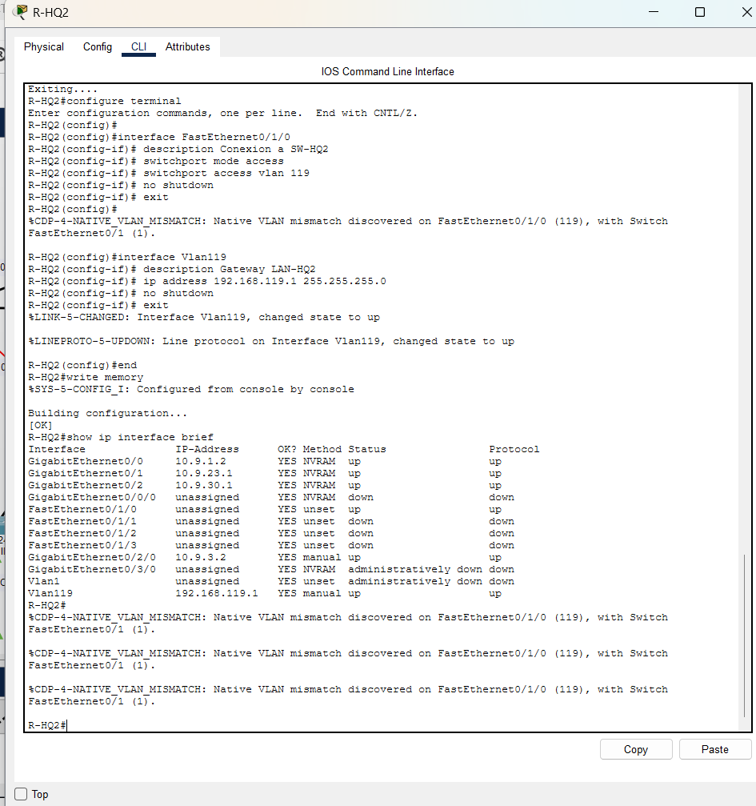
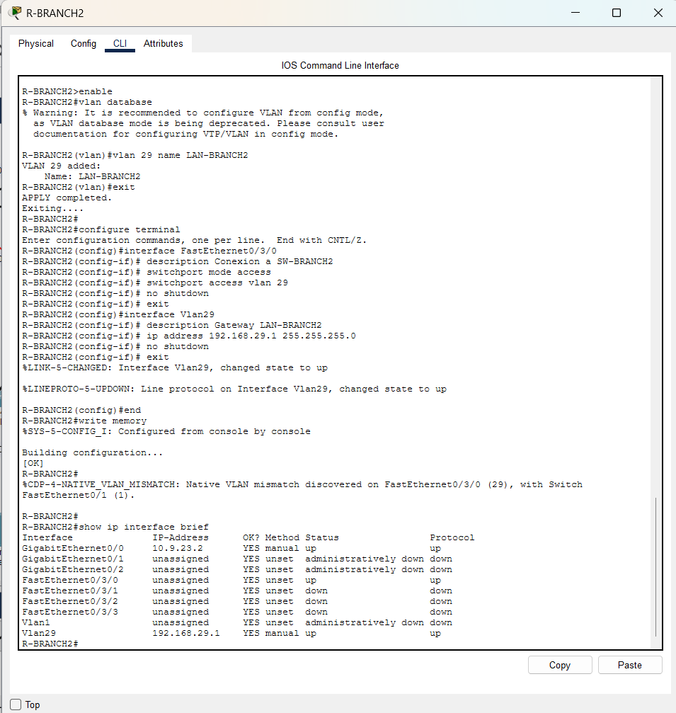
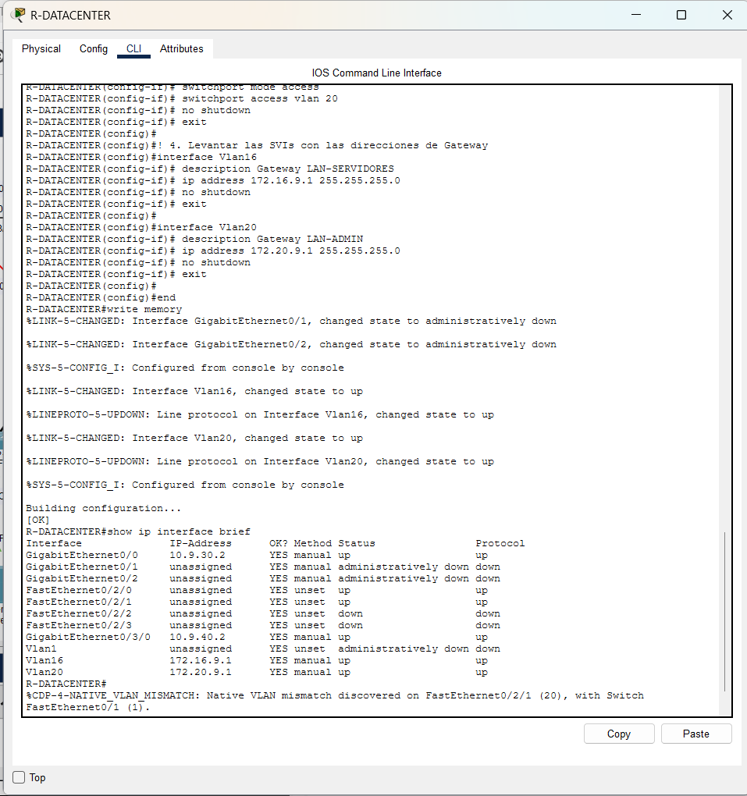
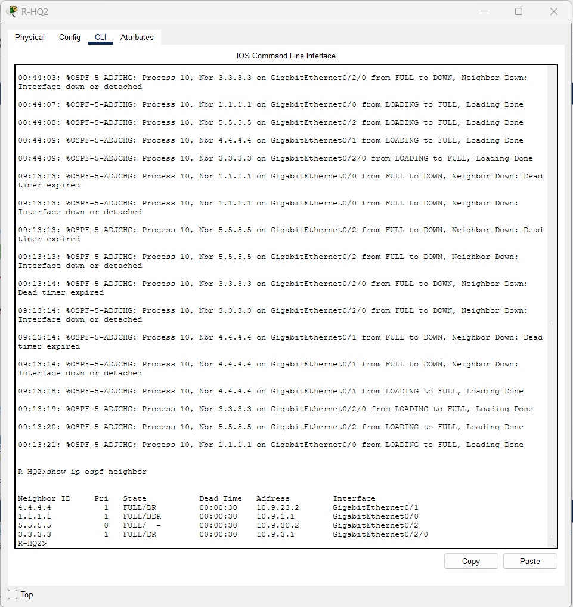
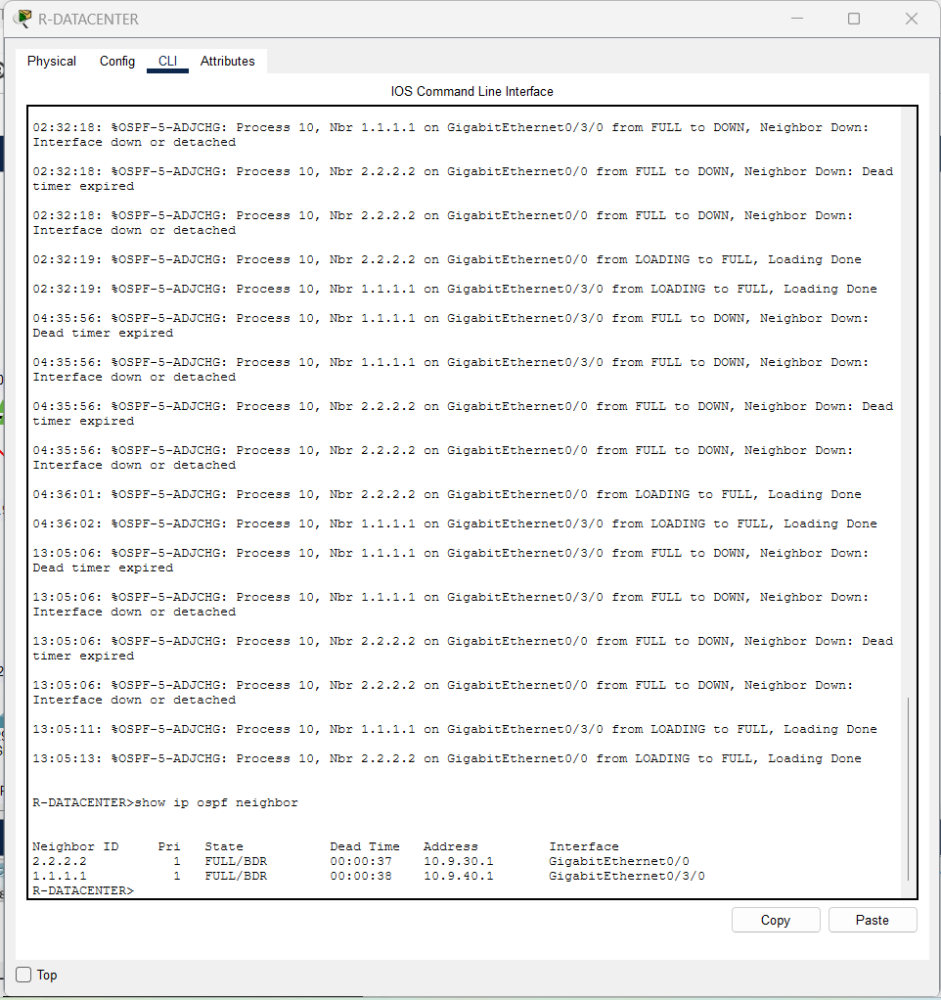
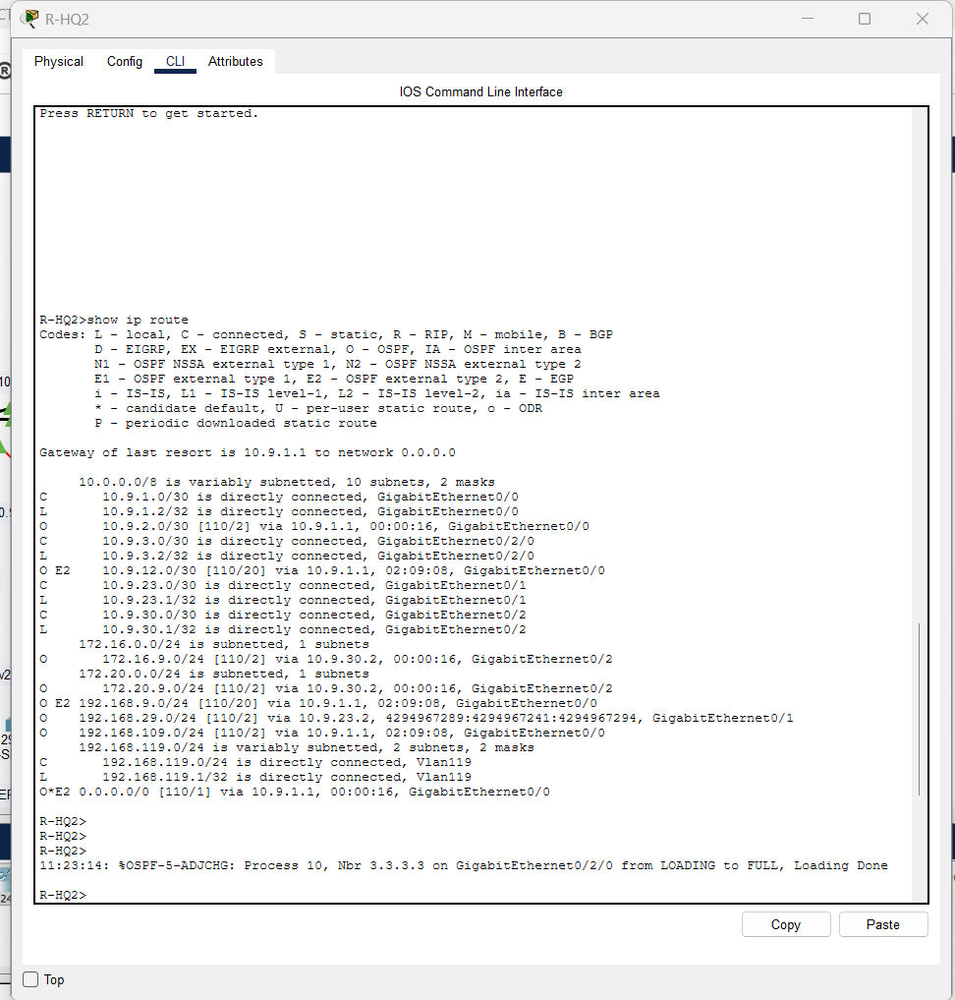
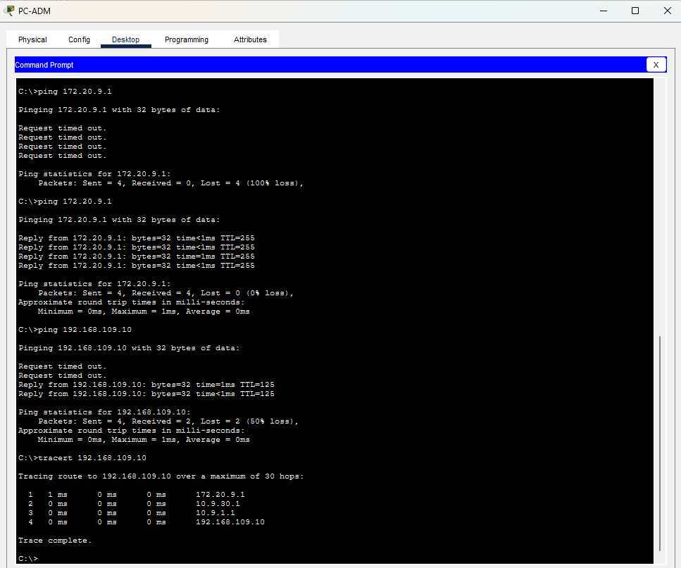
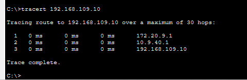
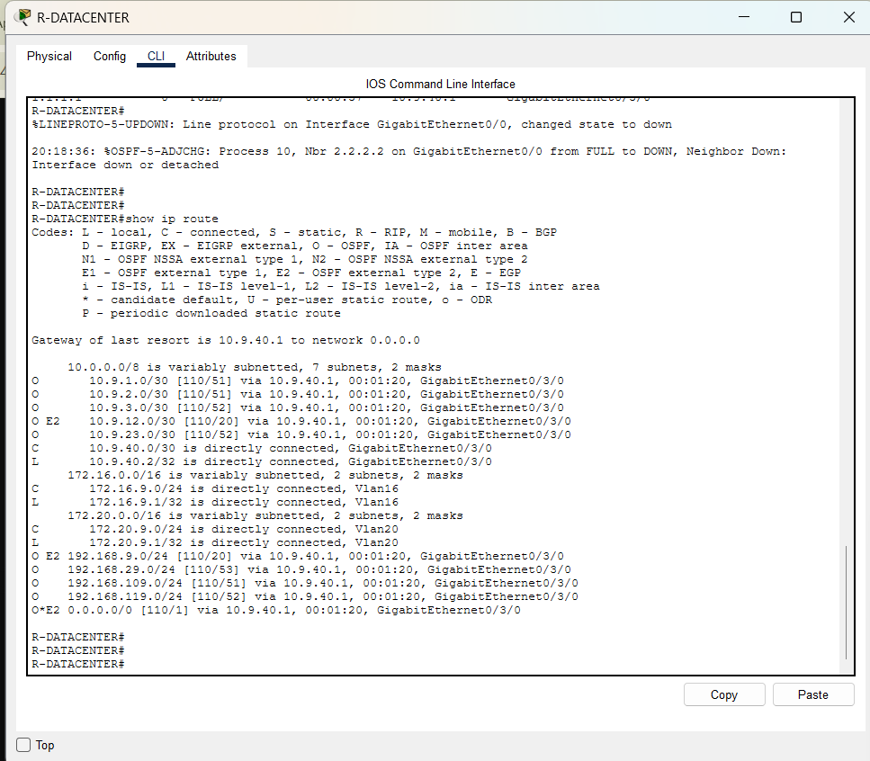
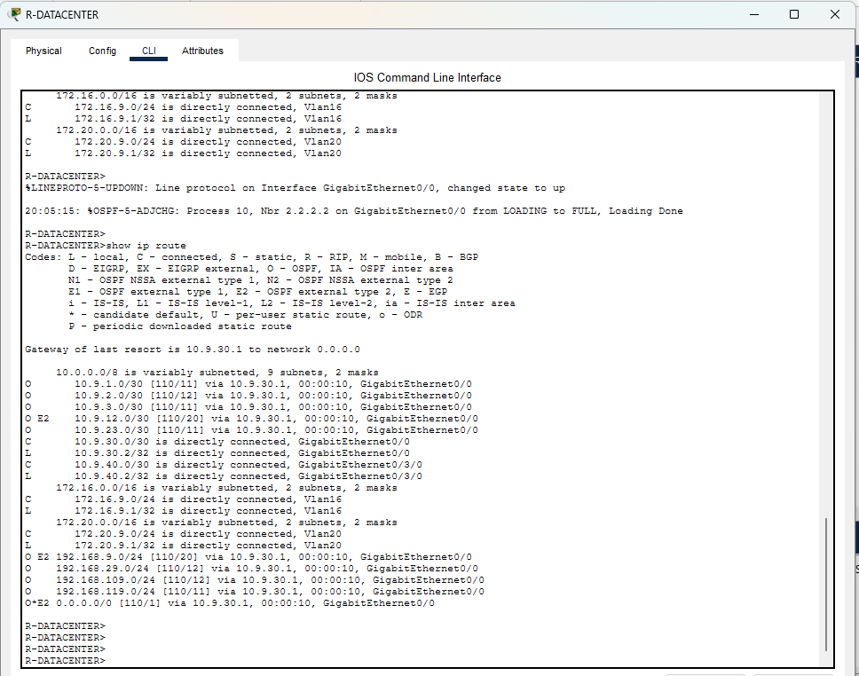

## 2.1 Plan de direccionamiento (segmentos del Integrante 2)

Valor de D = 9.

| Segmento | Red | Dispositivo | Interfaz | IP | Máscara | Rol / Uso |
|---|---|---|---|---|---|---|
| R-HQ1 ↔ R-HQ2 (backbone) | 10.9.1.0/30 | R-HQ2 | g0/0 | 10.9.1.2 | 255.255.255.252 | Enlace WAN Backbone OSPF |
| R-EDGE ↔ R-HQ2 | 10.9.3.0/30 | R-HQ2 | g0/2/0 | 10.9.3.2 | 255.255.255.252 | Enlace WAN Fibra Óptica Borde |
| R-HQ2 ↔ R-BRANCH2 | 10.9.23.0/30 | R-HQ2 | g0/1 | 10.9.23.1 | 255.255.255.252 | Enlace WAN Sucursal OSPF |
| | | R-BRANCH2 | g0/0 | 10.9.23.2 | 255.255.255.252 | Enlace WAN Sucursal OSPF |
| R-HQ2 ↔ R-DATACENTER (principal) | 10.9.30.0/30 | R-HQ2 | g0/2 | 10.9.30.1 | 255.255.255.252 | Enlace WAN Principal DC |
| | | R-DATACENTER | g0/0 | 10.9.30.2 | 255.255.255.252 | Enlace WAN Principal DC |
| R-HQ1 ↔ R-DATACENTER (redundante) | 10.9.40.0/30 | R-DATACENTER | g0/3/0 | 10.9.40.2 | 255.255.255.252 | Enlace WAN Redundante DC |
| LAN-HQ2 | 192.168.119.0/24 | R-HQ2 | Vlan119 | 192.168.119.1 | 255.255.255.0 | Gateway Casa Matriz HQ2 |
| | | PC-HQ2 | NIC | 192.168.119.10 | 255.255.255.0 | Estación Casa Matriz HQ2 |
| LAN-BRANCH2 | 192.168.29.0/24 | R-BRANCH2 | Vlan29 | 192.168.29.1 | 255.255.255.0 | Gateway Sucursal OSPF |
| | | PC-B2 | NIC | 192.168.29.10 | 255.255.255.0 | Estación Sucursal Branch 2 |
| LAN-SERVIDORES | 172.16.9.0/24 | R-DATACENTER | Vlan16 | 172.16.9.1 | 255.255.255.0 | Gateway Red Servidores |
| | | SERVER | NIC | 172.16.9.10 | 255.255.255.0 | Servidor de Servicios |
| LAN-ADMIN | 172.20.9.0/24 | R-DATACENTER | Vlan20 | 172.20.9.1 | 255.255.255.0 | Gateway Red Administración |
| | | PC-ADM | NIC | 172.20.9.10 | 255.255.255.0 | Estación de Administración |

Nota de implementación: al igual que en la sucursal legacy y HQ1, los accesos LAN en R-HQ2 (Fa0/1/0), R-BRANCH2 (Fa0/3/0) y R-DATACENTER (Fa0/2/0 y Fa0/2/1) están conectados a módulos de switch HWIC-4ESW. Por esta razón, se configuraron interfaces SVI (Vlan119, Vlan29, Vlan16 y Vlan20) asociadas a puertos de acceso en cada switch para proveer los gateways locales correspondientes.

---

## 3.1 Fase I - Construcción, cableado y direccionamiento (Parte Integrante 2)

Se completó la infraestructura física y lógica de los enrutadores asignados al Integrante 2 (R-HQ2, R-BRANCH2 y R-DATACENTER):

1. **Resolución de Enlace WAN R-EDGE ↔ R-HQ2:** Al tener los puertos integrados RJ-45 de R-HQ2 ocupados con R-HQ1, R-BRANCH2 y R-DATACENTER, el enlace hacia R-EDGE se conectó a través de los módulos transceptores HWIC-1GE-SFP (`g0/3/0` en R-EDGE y `g0/2/0` en R-HQ2), empleando cable de fibra óptica monomodo para habilitar la subred `10.9.3.0/30`.
2. **Implementación de SVIs para Segmentos LAN:** Se definieron las VLANs en la base de datos de los routers con módulos switch (`vlan database`) y se levantaron las interfaces virtuales SVI con sus respectivas direcciones IP (/24). Los switches correspondientes (SW-HQ2, SW-BRANCH2, SW-SERVIDORES y SW-ADMIN) fueron asignados a sus respectivas VLANs de acceso, evitando discrepancias de VLAN nativa.
3. **Configuración de Terminales:** Se configuraron las direcciones IPv4 estáticas, máscaras de subred y gateways en PC-HQ2, PC-B2, SERVER y PC-ADM.
4. **Verificación de Enlaces Directos:** Se comprobó conectividad local mediante pruebas ICMP (`ping`) hacia los enlaces vecinos directamente conectados y puertas de enlace.

**Evidencias:**

- Figura 7. Interfaces de R-HQ2 — `10_show_ip_int_brief_R-HQ2.png`



- Figura 8. Interfaces de R-BRANCH2 — `11_show_ip_int_brief_R-BRANCH2.png`



- Figura 9. Interfaces de R-DATACENTER — `12_show_ip_int_brief_R-DATACENTER.png`




## 6.1 Fase IV - OSPF en el Núcleo Corporativo y Data Center (Parte Integrante 2)

Se configuró el protocolo de enrutamiento dinámico OSPFv2 (proceso 10, área única 0) en los routers pertenecientes al dominio principal asignados al Integrante 2 (R-HQ2, R-BRANCH2 y R-DATACENTER), garantizando la sincronización de estados de enlace y la convergencia de toda la infraestructura:

1. **Definición de Identificadores de Enrutador (Router ID):** Se configuraron manualmente los Router IDs para garantizar estabilidad y evitar reelecciones arbitrarias:
   - `R-HQ2`: 2.2.2.2 (Backbone / Núcleo)
   - `R-BRANCH2`: 4.4.4.4 (Sucursal OSPF)
   - `R-DATACENTER`: 5.5.5.5 (Servidores y Gestión)
2. **Publicación de Subredes en Área 0:** Se declararon las redes WAN punto a punto (/30 con wildcard 0.0.0.3) y los segmentos de acceso LAN (/24 con wildcard 0.0.0.255) correspondientes a cada interfaz activa.
3. **Establecimiento de Adyacencias:** Se validó que las relaciones de vecindad alcanzaran el estado de sincronización completa (`FULL`), conformando la topología mallada en el núcleo corporativo.
4. **Inspección de la Tabla de Enrutamiento:** En R-HQ2 se comprobó la correcta recepción de las rutas internas del núcleo (`O`), la inyección de la ruta por defecto hacia la salida de Internet originada en R-EDGE (`O*E2 0.0.0.0/0`) y la propagación de la sucursal legacy mediante la redistribución mutua efectuada en R-HQ1 (`O E2 192.168.9.0/24`).

**Evidencias:**

- Figura 13. Adyacencias OSPF en R-HQ2 (vecinos FULL con R-HQ1, R-EDGE, R-BRANCH2 y R-DATACENTER) — `13_show_ip_ospf_neighbor_R-HQ2.png`



- Figura 14. Adyacencias OSPF en R-DATACENTER (vecinos FULL con R-HQ2 y R-HQ1) — `14_show_ip_ospf_neighbor_R-DATACENTER.png`



- Figura 15. Tabla de rutas de R-HQ2 (rutas OSPF internas, externas E2 y ruta por defecto) — `15_show_ip_route_R-HQ2.png`



## 7. Fase VI - Redundancia, Costos OSPF y Simulación de Fallas (Parte Integrante 2)

Para garantizar la alta disponibilidad y optimizar el flujo de tráfico en el núcleo corporativo, se aplicó ingeniería de costos OSPF y se evaluó la resiliencia de la red ante contingencias controladas:

1. **Ajuste de Métricas OSPF:** En R-DATACENTER se asignó un costo preferente de 10 a la interfaz `GigabitEthernet0/0` (enlace hacia R-HQ2) y un costo penalizado de 50 a la interfaz `GigabitEthernet0/3/0` (enlace redundante hacia R-HQ1). De este modo, el cálculo SPF selecciona de manera predeterminada el tránsito hacia R-HQ2 al ofrecer una métrica acumulada menor hacia los destinos del núcleo.
2. **Comprobación de Ruta Primaria:** Mediante el comando `tracert` ejecutado desde PC-ADM hacia la estación remota PC-HQ1 (192.168.109.10), se verificó el tránsito a través del camino preferente: R-DATACENTER → R-HQ2 → R-HQ1 → PC-HQ1.
3. **Simulación de Falla y Conmutación Dinámica:** Se provocó la desconexión del camino primario mediante el apagado administrativo (`shutdown`) de la interfaz `GigabitEthernet0/2` en R-HQ2. Al detectarse la pérdida del enlace, el proceso OSPF recalculó la topología y conmutó el tráfico de forma automática hacia el enlace redundante `10.9.40.0/30`, alcanzando a PC-HQ1 directamente a través del next-hop de R-HQ1 (10.9.40.1).
4. **Recuperación Automática:** Tras reactivar el enlace principal (`no shutdown`), la adyacencia OSPF se restableció en estado FULL y el árbol de rutas reincorporó la interfaz `GigabitEthernet0/0` como vía óptima sin requerir intervención administrativa.

**Evidencias:**

- Figura 16. Trazado de ruta desde PC-ADM hacia LAN-HQ1 antes de la falla — `16_tracert_PC-ADM_a_PC-HQ1_antes_falla.png`



- Figura 17. Trazado de ruta desde PC-ADM hacia LAN-HQ1 tras la falla — `17_tracert_PC-ADM_a_PC-HQ1_tras_falla.png`



- Figura 18. Tabla de rutas de R-DATACENTER durante la falla — `18_show_ip_route_R-DATACENTER_tras_falla.png`



- Figura 19. Tabla de rutas de R-DATACENTER tras la recuperación — `19_show_ip_route_R-DATACENTER_recuperado.png`




## 8. Fase VII - Caso de IA Aplicada al Enrutamiento (Parte Integrante 2)

Para cumplir con los requerimientos de la Fase VII, se evaluó el prototipo empresarial **AI Routing Advisor** analizando las salidas reales de Cisco IOS obtenidas en R-HQ2 y R-DATACENTER durante la prueba de ingeniería de costos y simulación de fallas.

### 8.1 Prompt entregado a la IA

```text
Actua como ingeniero de redes senior. A continuacion te comparto salidas reales
de Cisco IOS tomadas de dos routers del nucleo OSPF de una red empresarial. El
Data Center tiene dos caminos OSPF: uno principal por R-HQ2 (costo 10) y uno
redundante por R-HQ1 (costo 50). Durante la prueba se simulo una falla en el
enlace principal.

1. Identifica las adyacencias OSPF activas y en que area operan.
2. Determina que ruta esta instalada hacia la red 192.168.109.0/24 y explica
   por que, en terminos de costo OSPF.
3. Diagnostica si la red mantiene conectividad al Data Center durante la falla
   del enlace principal, usando como evidencia los costos y las interfaces
   visibles.
4. Explica la relacion entre `ip ospf cost` y la seleccion de ruta.
5. Propone tres comandos Cisco IOS para verificar la convergencia tras la falla.

Salidas reales adjuntadas:
[Salidas de show ip route, show ip ospf neighbor, show ip ospf interface brief y show ip protocols en R-HQ2 y R-DATACENTER]
```

### 8.2 Resumen de la Respuesta Generada por la IA

1. **Adyacencias OSPF:** Identificó que R-HQ2 opera en el Área 0 con 4 vecinos FULL (R-HQ1, R-EDGE, R-BRANCH2 y R-DATACENTER) y R-DATACENTER con 2 vecinos FULL (R-HQ2 y R-HQ1).
2. **Selección de Ruta y Métrica:** Determinó que hacia la LAN-HQ1 (`192.168.109.0/24`), R-DATACENTER instala la ruta vía R-HQ2 (`10.9.30.1`) con métrica acumulada 12 (`[110/12]`), producto de sumar el costo asignado al enlace principal (10) más los costos internos de tránsito Gigabit (1 + 1), prefiriéndola sobre el enlace redundante que acumula un costo de 51.
3. **Resiliencia ante Fallas:** Diagnosticó que la red mantiene conectividad ininterrumpida hacia el Data Center durante la caída del camino principal, pues el enlace redundante `10.9.40.0/30` asume el tráfico de inmediato conmutando al next-hop `10.9.40.1`.
4. **Ingeniería de Costos:** Explicó que el comando `ip ospf cost` sobrescribe la fórmula automática basada en el ancho de banda de referencia, permitiendo forzar rutas deterministas.
5. **Comandos Propuestos:** Recomendó el uso de `show ip ospf neighbor`, `show ip route ospf` y pruebas de plano de datos con `traceroute`.

### 8.3 Validación Técnica de la Respuesta de la IA

La recomendación técnica del asistente fue contrastada contra el comportamiento operativo en Cisco Packet Tracer:

* **Aspectos Correctos:** El desglose aritmético de las métricas de OSPF (`10 + 1 + 1 = 12` vs `50 + 1 = 51`) fue exacto y coincidió con las tablas de enrutamiento. Asimismo, la explicación del algoritmo Dijkstra frente al costo manual fue conceptualmente certera.
* **Aspectos Incompletos / Omitidos:** La IA asumió una reconvergencia inmediata y transparente, omitiendo advertir sobre el impacto de los temporizadores OSPF (*Dead Interval* de 40 s en medios broadcast) y pasando por alto la necesidad crítica de homologar los tipos de red (`ip ospf network point-to-point`), factor que previamente generó un bloqueo temporal en la instalación de rutas en R-HQ2.
* **Conclusión Crítica:** La IA demostró ser un asistente de soporte eficiente para el cálculo analítico de costos y la correlación de tablas de enrutamiento; no obstante, carece de visión contextual sobre particularidades de capa física y discrepancias de parámetros en interfaces, ratificando que toda recomendación de IA debe ser validada técnicamente por el administrador de red.

---

## 9. Tabla Preparatoria de Troubleshooting Oculto

Para afrontar la prueba de diagnóstico en vivo ante modificaciones no anunciadas por el docente, se estructuró la siguiente metodología de detección rápida:

| Posible Falla Provocada | Síntoma en la Red | Comando de Detección Inmediata | Acción Correctiva |
|---|---|---|---|
| Eliminación de comando `network` en RIP | La sucursal deja de alcanzar redes remotas | `show ip protocols` en R-BRANCH1 | Agregar `network <red>` bajo `router rip` |
| Wildcard errónea en OSPF | Falta de adyacencia o subred no publicada | `show running-config \| section ospf` | Corregir la máscara wildcard a `0.0.0.3` o `0.0.0.255` |
| Interfaz apagada administrativamente | Pérdida de adyacencia y caída de enlaces | `show ip interface brief` | Ingresar a la interfaz y aplicar `no shutdown` |
| Gateway o máscara alterada en Host | Host aislado sin salida fuera de su LAN | `ipconfig` en la estación afectada | Restablecer IP estática, máscara /24 y Gateway |
| Modificación de ruta estática / por defecto | Pérdida de salida a Internet | `show ip route static` en R-EDGE | Reconfigurar `ip route 0.0.0.0 0.0.0.0 200.10.9.2` |
| Supresión de `no auto-summary` en RIP | Rutas recibidas como clase mayor (/8 o /24) | `show ip protocols` en R-BRANCH1 | Aplicar `no auto-summary` en el proceso RIP |
| Modificación de IP o máscara en WAN | Adyacencia OSPF trabada en INIT o DOWN | `show ip interface brief` y `ping` al vecino | Homologar IPs dentro del segmento /30 correspondiente |
| Alteración no planificada de costo OSPF | Tráfico transitando por camino no óptimo | `show ip ospf interface brief` | Restablecer `ip ospf cost` al valor de diseño |

---

## 10. Preguntas Técnicas de Defensa (Parte Integrante 2)

**1. ¿Por qué OSPF es más adecuado para el núcleo que RIP?**  
Porque OSPF es un protocolo de estado de enlace sin límite de saltos (a diferencia de RIP que está limitado a 15 saltos), cuenta con convergencia rápida mediante el algoritmo Dijkstra (SPF), calcula métricas basadas en costo real (ancho de banda) en lugar de saltos ciegos, soporta diseño jerárquico por áreas y genera menor sobrecarga al enviar actualizaciones disparadas por eventos (*triggered updates*) en lugar de tablas periódicas completas.

**3. ¿Qué representa el costo en OSPF?**  
Representa el costo métrico acumulado de los enlaces para alcanzar una red de destino. Por defecto, Cisco IOS lo calcula inversamente proporcional al ancho de banda mediante la fórmula $\text{Costo} = \frac{\text{Ancho de Banda de Referencia}}{\text{Ancho de Banda de la Interfaz}}$ (típicamente $10^8 / \text{BW}$). A menor costo acumulado, mayor es la preferencia del camino seleccionado por Dijkstra.

**4. ¿Cuál es la diferencia entre métrica y distancia administrativa?**  
La **Distancia Administrativa (AD)** evalúa la confiabilidad entre *diferentes protocolos de enrutamiento* (ej. Estática = 1, OSPF = 110, RIP = 120) para decidir qué protocolo instala la ruta en la tabla de enrutamiento (RIB). La **métrica** es el valor numérico interno que utiliza un *mismo protocolo* (ej. saltos en RIP, costo en OSPF) para seleccionar el mejor camino entre múltiples rutas alternativas dentro de su propio dominio.

**7. ¿Qué ocurre cuando un vecino OSPF deja de estar disponible?**  
Si el enlace físico se desconecta, la interfaz pasa a down y la adyacencia cae de inmediato. Si el enlace físico permanece activo pero el vecino deja de responder, el router local espera a que expire el *Dead Interval* (por defecto 40 segundos en broadcast/point-to-point). Al expirar el temporizador, la adyacencia pasa a `DOWN`, el enrutador genera un nuevo LSA Tipo 1 (Router LSA) notificando el cambio, lo inunda en el área y ejecuta el algoritmo SPF para recalcular las rutas omitiendo al vecino inalcanzable.

**8. ¿Cómo se verifica una adyacencia OSPF?**  
Mediante el comando `show ip ospf neighbor`. Una adyacencia operativa debe figurar en estado **`FULL`** (o `2-WAY` entre routers DROTHER en segmentos multiacceso). Para detalles de temporizadores, direcciones y prioridad se complementa con `show ip ospf neighbor detail`.

**10. ¿Puede una IA reemplazar OSPF? Justifique.**  
No. OSPF opera en el plano de control distribuido dentro de los enrutadores en tiempo real (milisegundos), garantizando el intercambio de estados de enlace y la prevención algorítmica de bucles en hardware de red. Una IA opera en el plano de gestión y supervisión analítica (asistiendo en diagnóstico, detección de anomalías o planificación de tráfico), pero no cuenta con la capacidad de convergencia determinista local ni con la tolerancia a fallas descentralizada en milisegundos que exige el protocolo en tiempo real.

**12. ¿Por qué una recomendación de IA debe validarse antes de aplicarse?**  
Porque los modelos de IA basan sus respuestas en correlación de patrones y pueden incurrir en alucinaciones, omitir particularidades físicas de la topología (como módulos switch de capa 2 o tipos de red en interfaces) o desconocer directivas de diseño corporativo. Aplicar configuraciones sugeridas sin validación previa en producción puede provocar caídas de servicio, bucles de enrutamiento o inconsistencias de conectividad.

---

## 11. Resumen Ejecutivo y Metodología del Proyecto

### Resumen Ejecutivo
El presente proyecto integrador consolidó el rediseño y modernización de la infraestructura corporativa de **TecnoRed Guatemala, S.A.** Se logró la convergencia global de la red integrando tres esquemas de enrutamiento: enrutamiento estático con salida por defecto y flotante resiliente, enrutamiento dinámico vectorial heredado (RIPv2 en Sucursal Norte) y enrutamiento dinámico de estado de enlace (OSPFv2 Área 0 en el Núcleo y Sucursal Sur). Mediante redistribución mutua en R-HQ1 y manipulación de costos OSPF en R-DATACENTER, la topología demostró alta disponibilidad, redundancia transparente ante fallas de enlaces principales y plena interoperabilidad multidominio sin recurrir a rutas estáticas punto a punto. Asimismo, se incorporó un flujo metodológico de diagnóstico apoyado en Inteligencia Artificial, validando su efectividad y delimitando su alcance operativo frente a la supervisión técnica humana.

### Metodología de Implementación
1. **Diseño y Segmentación VLSM:** Planificación del direccionamiento utilizando el parámetro personalizado $D = 9$, segmentando enlaces WAN punto a punto (/30) y redes de acceso de usuarios y servidores (/24).
2. **Capa Física y Conectividad Local:** Cableado de infraestructura (cobre directo y fibra monomodo para el enlace Core R-EDGE ↔ R-HQ2), resolución de puertos switch mediante interfaces SVI en routers 2911, normalización de VLANs de acceso y validación ICMP vecino a vecino.
3. **Despliegue Progresivo de Protocolos:** Activación de rutas estáticas de borde, habilitación de RIPv2 con máscaras reales (`no auto-summary`), configuración del proceso OSPF 10 con Router IDs fijos y establecimiento de la redistribución mutua en el ASBR (R-HQ1).
4. **Ingeniería de Tráfico y Resiliencia:** Asignación de métricas OSPF diferenciadas (costo 10 principal vs. costo 50 redundante), ejecución de pruebas de trazabilidad de paquetes (`tracert`) y comprobación de conmutación automática mediante simulación de caídas administrativas.
5. **Auditoría con IA y Defensa Técnica:** Recopilación de telemetría de Cisco IOS, interacción con el asistente inteligente, validación empírica en laboratorio y preparación de procedimientos de troubleshooting.

---

## 12. Conclusiones Generales

1. La coexistencia armónica de protocolos heterogéneos (RIPv2 y OSPF) es viable y eficiente mediante redistribución mutua en enrutadores de frontera (ASBR), permitiendo preservar segmentos de red heredados sin comprometer la velocidad de convergencia del núcleo corporativo.
2. La ingeniería de costos OSPF (`ip ospf cost`) y las rutas estáticas flotantes constituyen mecanismos complementarios y deterministas para garantizar la continuidad operativa del negocio ante contingencias de conectividad en el Data Center.
3. El uso de interfaces virtuales de conmutación (SVIs) en enrutadores modulares permite resolver limitaciones de puertos físicos de Capa 3 manteniendo la coherencia de diseño y la compatibilidad con dispositivos finales.
4. Las herramientas de Inteligencia Artificial representan un recurso valioso para acelerar el análisis y la interpretación de diagnósticos en infraestructuras de red complejas; no obstante, su función debe ser estrictamente consultiva, requiriendo siempre la validación y el criterio técnico del ingeniero de redes antes de su aplicación en producción.